# Resolution-Drift Diffusion

Resolution-Drift Diffusion (RDD) turns a standard DiT into a coarse-to-fine
generator. A single resolution-conditioned DiT denoises small latent grids at
high noise and progressively moves to the full latent resolution. The method
changes the probability path and stage transitions while keeping the DiT
backbone almost unchanged.

This repository contains the validated ImageNet-256 implementation and the
experiments summarized below. All formal image metrics use the native
ImageNet directory loader, 50,000 generated images, and ADM reference
statistics. Historical runs trained with a different preprocessing pipeline
are excluded.

## Highlights

- RDD Unified-XL/2 reaches **FID 7.065** at 400K updates without guidance,
  compared with **FID 19.781** for DiT-XL/2 at the same training budget.
- With CFG 1.5, the same RDD checkpoint reaches **FID 3.537**.
- A drift-aware midpoint solver improves the matched approximately 250-NFE
  result to **FID 2.626**.
- The measured DDPM-250 denoising benchmark is **1.90x faster** for Unified-XL/2
  than fixed-resolution DiT-XL/2 because early updates use fewer tokens.
- Controlled allocation experiments favor three stages and a 300/300/400
  fine/middle/coarse training split among the tested schedules.

## Qualitative samples

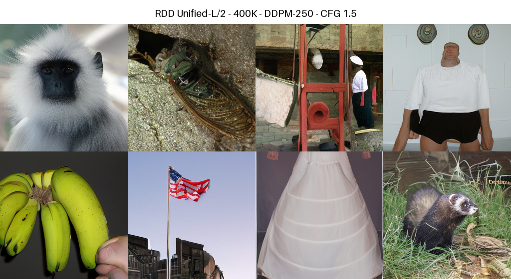

Unified-L/2 at 400K updates, trained with the 300/300/400
fine/middle/coarse allocation and sampled with DDPM 80/80/90, CFG 1.5, and
noise-filling transitions. The images are selected by fixed sample index, not
by visual ranking.

## Method

Standard VP diffusion uses

$$
x_t=\sqrt{\bar\alpha_t}x_0+\sqrt{1-\bar\alpha_t}\epsilon.
$$

Within resolution stage $c$, RDD adds a deterministic residual that connects
the current clean latent to the lifted representation from the preceding
coarser stage:

$$
x_t^{(c)}=\sqrt{\bar\alpha_t}
\left[x_0^{(c)}+\lambda_c(t)\left(G_c(x_0^{(c)})-x_0^{(c)}\right)\right]
+\sqrt{1-\bar\alpha_t}\epsilon.
$$

The implementation adds three components to DiT:

1. A resolution embedding shared by all stages.
2. A training target that includes the known resolution-drift contribution.
3. A noise-filling boundary transition that upsamples the clean prediction
   and initializes the finer-stage marginal with Gaussian noise.

The default latent trajectory is `8x8 -> 16x16 -> 32x32`. Unified models reuse
one DiT across all stages; multistage models use one network per stage.

## Main ImageNet-256 results

Unless noted otherwise, RDD uses DDPM, 250 actual NFE, noise filling, and the
300/300/400 fine/middle/coarse allocation.

| Model | Update | CFG | FID | sFID | IS | Precision | Recall |
|---|---:|---:|---:|---:|---:|---:|---:|
| DiT-XL/2 | 400K | 1.0 | 19.781 | 6.164 | 67.59 | 0.635 | 0.622 |
| DiT-XL/2 | 500K | 1.0 | 17.464 | 6.183 | 75.10 | 0.643 | 0.629 |
| RDD Unified-L/2 | 400K | 1.0 | 8.456 | 4.399 | 118.62 | 0.706 | 0.624 |
| RDD Unified-XL/2 | 400K | 1.0 | **7.065** | 4.332 | 130.19 | 0.717 | 0.629 |
| RDD Unified-XL/2 | 400K | 1.5 | **3.537** | 5.166 | 275.52 | 0.868 | 0.507 |

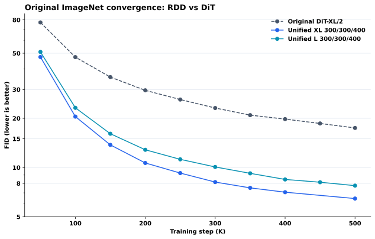

The measured 50K--500K curve shows faster convergence than fixed-resolution
DiT. The missing RDD 450K point is left missing rather than interpolated.

## Allocation and architecture ablations

For Unified-L/2 at 400K, the tested training schedules rank as
`300/300/400 > 400/300/300 > 100/300/600 > 600/300/100`. Three stages also
outperform the tested two-stage paths: FID 8.456 for `8->16->32`, 10.643 for
`16->32`, and 11.978 for direct `8->32`.

<table>
<tr>
<td width="50%">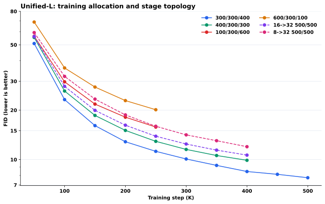<br><b>Training allocation</b></td>
<td width="50%">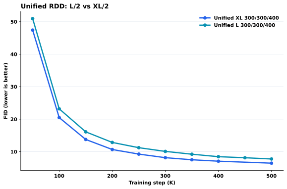<br><b>Model scale</b></td>
</tr>
<tr>
<td width="50%">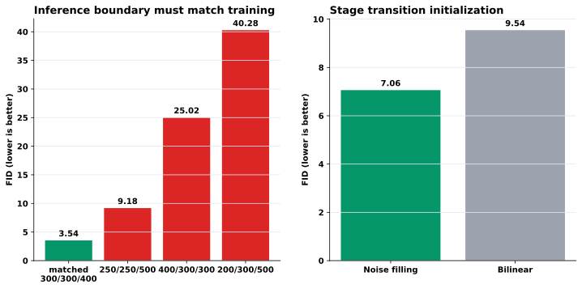<br><b>Boundary and transition controls</b></td>
<td width="50%">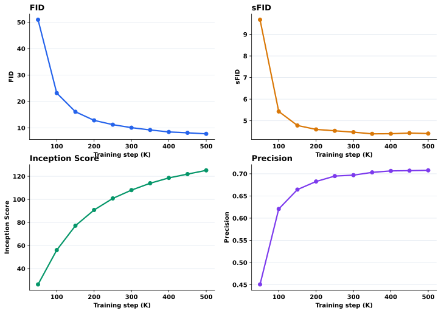<br><b>FID, sFID, IS, and precision</b></td>
</tr>
</table>

## Sampling, guidance, and solver

Within the tested fixed 250-NFE budget, allocating more updates to the final
32x32 stage improves FID. CFG improves fidelity and precision at the expected
cost in recall. Noise filling substantially outperforms the tested bilinear
boundary initialization.

| Sampler | Scheduled updates | Actual NFE | CFG | FID |
|---|---:|---:|---:|---:|
| DDPM | 250 | 250 | 1.5 | 3.537 |
| Drift-aware DPM2 | 125 | 244 | 1.5 | **2.626** |
| Drift-aware DPM2 | 65 | 124 | 1.5 | 3.325 |
| Drift-aware DPM2 | 35 | 64 | 1.5 | 11.761 |

The midpoint method uses almost two model evaluations per scheduled update.
At matched approximately 250 NFE it improves FID by 25.8%; the 64-NFE point
shows that aggressive reduction is not yet reliable.

<table>
<tr>
<td width="50%">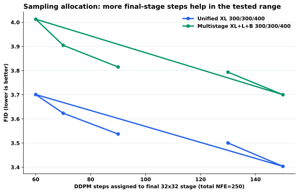<br><b>Sampling allocation</b></td>
<td width="50%">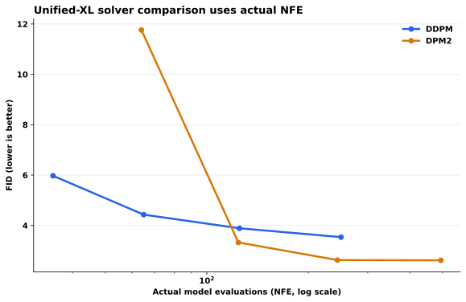<br><b>Solver versus actual NFE</b></td>
</tr>
<tr>
<td colspan="2">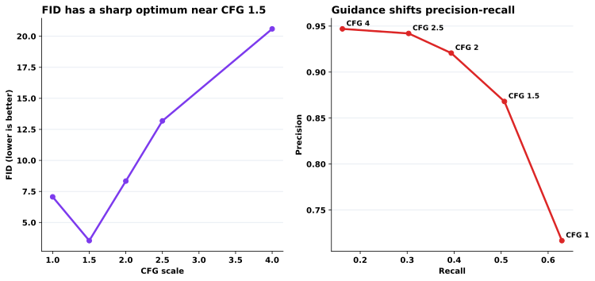<br><b>Guidance trade-off</b></td>
</tr>
</table>

## Flow-matching implementation

RDD-FM uses a separately derived velocity target on the same coarse-to-fine
path. Corrected Unified-L runs are still early and are reported separately
from the legacy Unified-XL checkpoint.

| Model | Update | Solver / actual NFE | CFG | FID |
|---|---:|---|---:|---:|
| Corrected RDD-FM Unified-L | 50K | Euler / 252 | 1.0 | 66.993 |
| Matched RDD diffusion Unified-L | 50K | DDPM / 250 | 1.0 | 50.943 |
| Legacy RDD-FM Unified-XL v2 | 400K | Euler / 252 | 1.0 | 14.617 |
| Legacy RDD-FM Unified-XL v2 | 400K | Euler / 252 | 1.5 | 3.359 |
| Legacy RDD-FM Unified-XL v2 | 400K | midpoint / 252 | 1.5 | **3.291** |

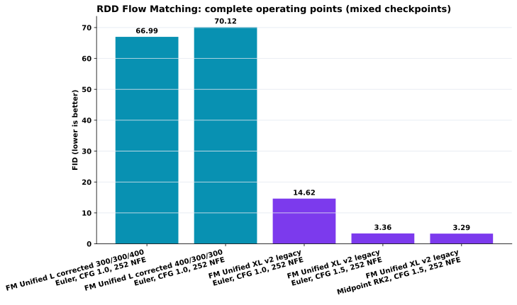

## Measured structural efficiency

| Model | H20 DDPM-250 latency | Speedup vs. DiT-XL/2 |
|---|---:|---:|
| DiT-XL/2 | 1333.4 ms/image | 1.00x |
| RDD Unified-XL/2 | 703.4 ms/image | 1.90x |
| RDD Multistage XL+L+B | 596.6 ms/image | 2.24x |
| RDD Unified-L/2 | 520.9 ms/image | **2.56x** |

These measurements isolate conditional denoising and are not end-to-end CFG
throughput. Failed distillation, hidden-state reuse, and sparse-attention
experiments are intentionally not included.

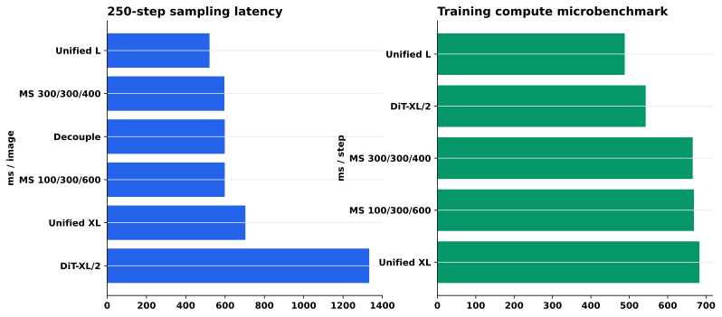

## Training

Install the Python dependencies and provide the native ImageNet directory:

```bash
pip install -r requirements.txt

torchrun --standalone --nproc_per_node=8 \
  2d/train_RDD_imagenet256_unified.py \
  --model DiT-L/2 \
  --resolutions 32,16,8 \
  --stage-lengths 300,300,400 \
  --data-source imagenet \
  --data-path /path/to/imagenet/train \
  --global-batch-size 256 \
  --max-train-steps 400000 \
  --ckpt-every 50000
```

For corrected flow matching, use `2d/train_RDD_FM_imagenet256_unified.py`.
Its stage lengths are expressed in generation order, so the matched command
uses `--stage-lengths 400,300,300` for coarse/middle/fine.

## Evaluation

`2d/sample_fid_unified.py` accepts one JSON object per line. Start from
`configs/eval_unified_l_400k.jsonl`, replace the checkpoint and output paths,
then run one process per GPU:

```bash
python scripts/download_checkpoint.py \
  --filename checkpoints/RDD-Unified-L/0400000.pt

for rank in 0 1 2 3; do
  CUDA_VISIBLE_DEVICES=$rank python 2d/sample_fid_unified.py \
    --config configs/eval_unified_l_400k.jsonl \
    --rank $rank --world-size 4 --batch-size 128 &
done
wait
```

Automatic evaluation expects the ADM ImageNet-256 reference archive at
`eval_results/reference/VIRTUAL_imagenet256_labeled.npz`. Raw checkpoints and
evaluation logs are archived in the
[experiment repository](https://huggingface.co/yang335/search_agent_hl_to_i18n_transport).

## Repository layout

| Path | Purpose |
|---|---|
| `2d/` | RDD diffusion/FM training, sampling, and evaluation |
| `DiT/` | Original and resolution-conditioned DiT backbones |
| `diffusion/` | Diffusion, drift, flow-matching, and transition equations |
| `guided-diffusion/` | ADM metric implementation |
| `configs/` | Portable sampling configurations |
| `results/metrics.json` | Machine-readable summary of reported values |
| `assets/results/` | Curated plots used in this README |

## Evaluation policy

- Native ImageNet and alternative preprocessing runs are never mixed.
- Curves hold checkpoint identity, sampler, NFE, CFG, sampling split,
  training boundary, and transition fixed unless the plotted axis changes it.
- Missing measurements remain missing.
- Pilot diagnostics are not presented as formal 50K metrics.
