# RDD 全量实验记录与可视化审计

生成日期：2026-09-18

这份记录先覆盖 Hugging Face 仓库和 surfi2 上发现的全部 `.log` / `.txt`，第二轮又覆盖 JSON/JSONL/CSV/TSV/Markdown/YAML/TOML/Python/Shell/PowerShell/TeX/RST/HTML/SVG。大文件采用流式抽取；原始记录保持不变，主结论只读取经过 provenance 与协议审核的 canonical 表。

## 1. 覆盖范围

| item | count |
|---|---|
| HF/surfi2 .log/.txt unique sources | 5428 |
| HF sources | 4473 |
| surfi2 sources | 2624 |
| Raw FID blocks | 751 |
| FID parse failures | 0 |
| Canonical paper-valid rows | 116 |
| Canonical old-HF invalid rows | 252 |
| Duplicate/conflict audit rows | 251 |
| All structured/code text sources | 42832 |
| Project-owned structured/code sources | 5934 |
| Broad structured FID hits | 1677 |
| Broad structured speed hits | 50668 |
| New paper-valid 50K FID from second pass | 0 |
| Recovered diagnostic FID rows | 13 |

关键数据文件：

- `eval_results/experiment_ledger_20260918/source_inventory.csv`：5,428 个文本源的完整 inventory。
- `eval_results/experiment_ledger_20260918/raw_fid_blocks.csv`：751 个原始 FID blocks，不去重。
- `eval_results/experiment_ledger_20260918/all_fid_blocks_classified.csv`：每个 block 的自动分类与理由。
- `eval_results/experiment_ledger_20260918/curated_valid_results.csv`：论文可用/带 caveat 的 canonical 结果。
- `eval_results/experiment_ledger_20260918/historical_invalid_results.csv`：旧错误数据集的 canonical 结果。
- `eval_results/experiment_ledger_20260918/duplicate_conflict_audit.csv`：镜像、冲突、误标与有效重复。
- `eval_results/experiment_ledger_20260918/structured_fid_source_audit.csv`：所有结构化 FID 命中的来源级分类。
- `eval_results/experiment_ledger_20260918/structured_speed_source_audit.csv`：所有结构化速度命中的来源级分类。
- `eval_results/experiment_ledger_20260918/curve_anomaly_audit.csv`：旧图尖峰的逐项根因与修复。
- `eval_results/experiment_ledger_20260918/acceleration_evidence_summary.csv`：按任务/协议隔离的加速结果。

## 2. 清洗规则

1. **数据 provenance 优先于 FID 数值。** 原生 ImageNet checkpoint 才能进入 A 级。旧 `saved/all_logs` 来自错误 HF-preprocessed 数据，整组隔离。
2. `logs/remote/saved/all_logs` 是 `saved/all_logs` 的镜像副本，逐路径去重。
3. 对相同设置的冲突结果，使用 checkpoint / dataset / evaluator 证据与用户确认，不使用“挑更低 FID”的方法。FID 本来就是越低越好，所以“低的有问题”在这里应理解为质量更差的那个，即更高 FID，且仍需 provenance 支持。
4. 独立重复不自动删除。Unified-XL 400K 的 7.06155 与 7.06508、DiT 500K 的 17.47415 与 17.46357 都是合理波动；主表保留 canonical 主值并在审计表记录 repeat。
5. 10K CSRA、low-pass 和 stage diagnostics 单列为 pilot/diagnostic，不与正式 50K FID 混图。
6. 缺失指标留空，不插值。Unified-XL 450K 明确留空。
7. 收敛线必须固定完整协议。相同 checkpoint 下的 bilinear、proportional sampling、重复评估和故意错配边界只能作为独立点或对照柱，不能按时间连接。
8. 结构化文件中的 `FID` 可能是代码变量、论文引用值、派生差值或已生成 ledger 的副本；只有原始实验产物且 protocol 明确时才晋级。

## 3. 最重要的结论

1. 在控制模型架构后，Unified-L 的训练分配排序非常稳定：300/300/400 最好，其次 400/300/300，再到 100/300/600，600/300/100 最差。固定 90/80/80 与 interval-proportional NFE250 都保持同一排序。
2. 三阶段优于两阶段。400K 时 Unified-L 300/300/400 FID 8.456；16→32 的 500/500 为 10.643；直接 8→32 的 500/500 为 11.978。省掉中间 16×16 会进一步损失。
3. 训练与推理边界必须匹配。仅修改推理 stage_lengths 会把 Unified-XL FID 从 3.537 恶化到 9.183、25.023 或 40.282，这不能冒充训练分配 ablation。
4. 在固定 DDPM 250 NFE、CFG1.5 的已测范围内，更多步数给最终 32×32 stage 更好；Unified-XL 从 60 个 fine steps 的 3.701 攆到 150 个的 3.404。
5. DPM2 的 scheduled steps 不是 NFE。按实际 NFE 比较，它在约 124–244 NFE 有优势，但约 64 NFE 明显失稳。
6. CFG1.5 是 Unified-XL 当前 FID 最优 operating point。继续增大 CFG 会提高 precision/IS，同时显著降低 recall 并恶化 FID。
7. corrected Unified-L FM 在 50K 仍弱于对应 diffusion：66.993 vs 50.943（300/300/400），70.121 vs 55.458（400/300/300）。legacy FM-XL 的 CFG1.5 很强，但其时间边界语义和 guidance operating point 不同，不能据此宣称 FM 收敛更快。
8. 旧 HF-preprocessed 数据训练的 252 个 canonical FID blocks 全部隔离到 H 级。它们可用于提出 sampler/分配假设，不能用于论文绝对数值或与原生 ImageNet 直接比较。
9. 严格固定 sampler、NFE、CFG、transition、sampling split 与推理边界后，8 条正式训练曲线的 FID 上升次数均为 0。旧图中的尖峰来自把不同协议连线，不是训练突然退化。
10. 第二轮又扫描了 JSON/JSONL/CSV/TSV/Markdown/YAML/TOML/Python/Shell/TeX/HTML/SVG 等 42,832 个文本源；剔除环境与 third-party 后有 5,934 个项目源。没有发现遗漏的论文级 50K FID，但补回 13 条 CSRA/low-pass 10K 诊断记录。
11. 加速结果必须按协议隔离：2D DDPM250 结构 microbenchmark、attention-reuse proxy、未微调 FastWan 视频计时和 RDD-3D runtime 不能横向混成一个 SOTA 表。3-step DMD 目前也没有质量合格的正式 FID。

## 4. 图表

### 4.1 RDD 与 DiT 收敛曲线

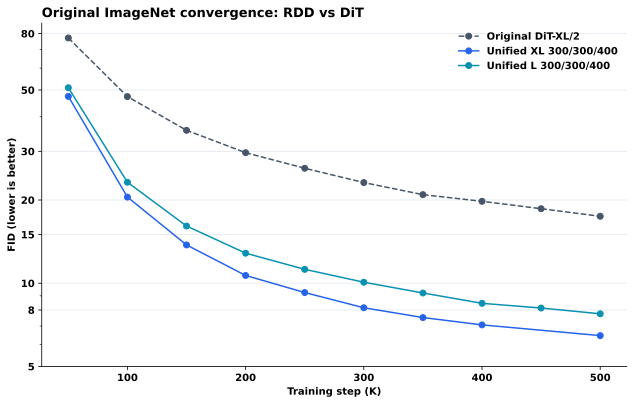

相同 DDPM250、CFG1.0、50K 评估；Unified XL 的 450K 留空，不插值。

### 4.2 Unified-L 训练分配与阶段数

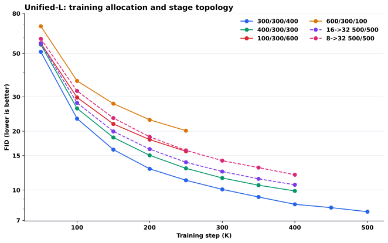

共享同一个 L/2 模型，消除了 multistage 模型容量不一致的混杂因素。

### 4.3 Unified 模型大小

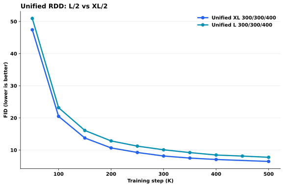

相同训练/采样分配下，XL 在整条曲线上优于 L；不能把模型大小优势误写成分配优势。

### 4.4 仅 Flow Matching

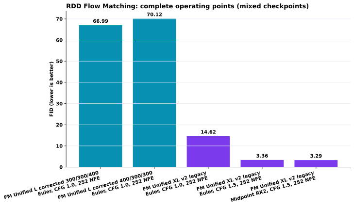

legacy XL 是 400K，corrected L 是 50K；边界语义和 CFG 也不同。本图只列 operating points，不是收敛曲线。

### 4.5 Diffusion 与 corrected FM 的 50K 对比

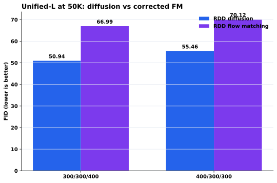

当前 FM 配置在 50K 明显更差；不能依据 legacy XL 的 CFG1.5 单点宣称 FM 收敛更快。

### 4.6 固定总 NFE 的采样步数分配

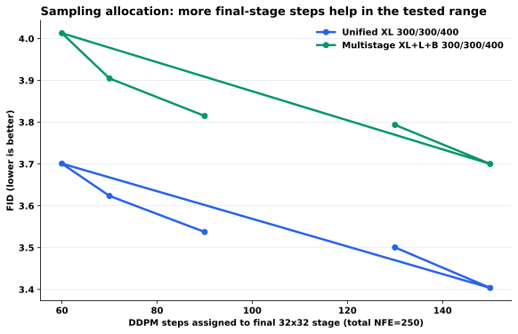

在已测范围内，把更多步数给最终 32×32 stage 可稳定降低 FID。

### 4.7 DDPM 与 DPM2 的实际计算量

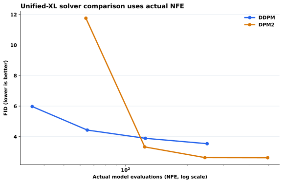

DPM2 在约 124–244 NFE 有优势，但约 64 NFE 时明显失稳；scheduled steps 不能当 NFE。

### 4.8 CFG 与 Precision–Recall

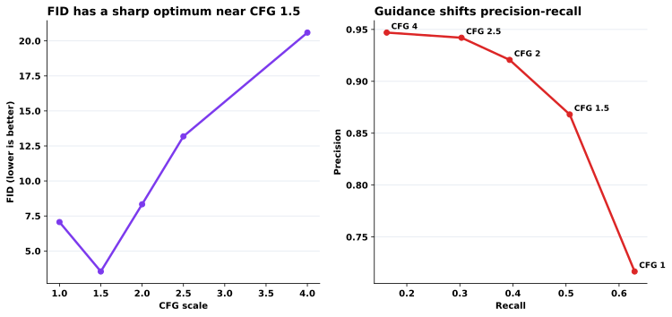

CFG1.5 最优 FID；更大 CFG 继续提高 precision/IS，但以 recall 和 FID 为代价。

### 4.9 边界匹配与 stage transition

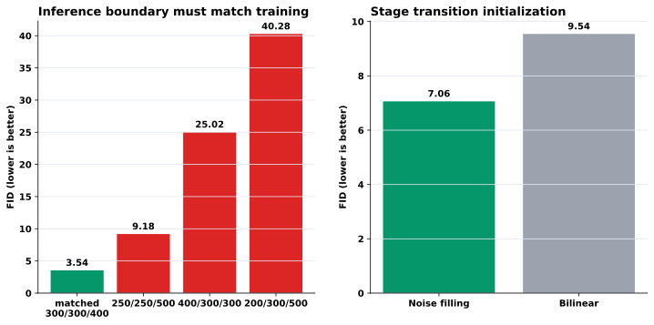

推理边界错配会严重恶化；noise filling 比 bilinear 的 FID 低约 26%。

### 4.10 固定与区间比例采样

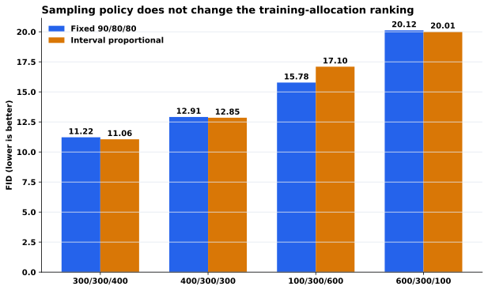

改变推理分配后，300/300/400 > 400/300/300 > 100/300/600 > 600/300/100 的排序完全不变。

### 4.11 Unified-L 的多指标收敛

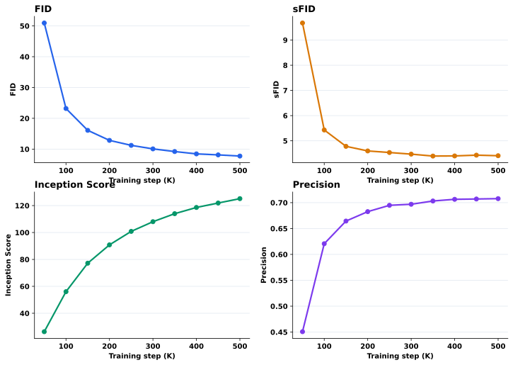

FID、sFID、IS、precision 的完整轨迹；避免只凭 FID 误判质量/多样性。

### 4.12 速度实验

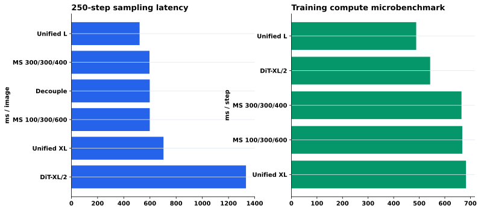

250-step sampling 是单前向、无 CFG 的 H20 benchmark；training 是单卡 microbenchmark，不是端到端 8-GPU throughput。

### 4.13 旧错误数据集结果的分布

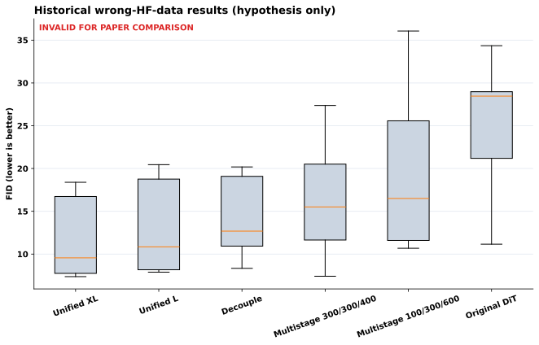

只用于检查趋势和生成假设，绝不能与原生 ImageNet 的绝对 FID 混表。

### 4.14 400K 的主要 operating points

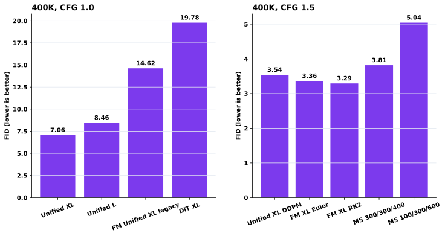

CFG1.0 与 CFG1.5 分面显示，防止把不同 guidance 强度当成同一收敛协议。

### 4.15 结构化 JSON 中恢复的 CSRA 10K 指标

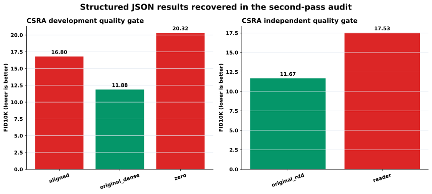

这些是第二轮扫描补入的 10K 诊断，不能与正式 50K FID 混图；独立 reader 使 FID 从 11.674 上升到 17.527。

### 4.16 加速证据按协议分组

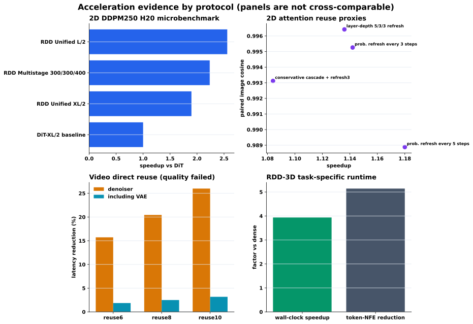

2D、视频与 3D 的硬件、任务和质量门槛不同，因此只在各自面板内比较。视频 direct reuse 虽降低 denoiser 延迟，但质量失败且 VAE 稀释了端到端收益。

## 5. 第二轮结构化文件补充

结构化扫描没有发现新的论文级 50K FID。新增的数值属于 10K CSRA、low-pass 诊断、旧错误数据 JSON、已有收敛 TSV 的副本，或文档/代码中的引用与变量。下面列出可作为诊断证据的 13 行；它们不进入主 50K 曲线。

| protocol | variant | fid | sfid | inception_score | precision | recall | source_repo_path |
|---|---|---|---|---|---|---|---|
| CSRA development 10K | aligned | 16.8040 | 18.3741 | 97.6982 | 0.6495 | 0.6929 | eval_results/csra_prefix6_fid10k_20260914/metrics/summary_fid10k.json |
| CSRA development 10K | original_dense | 11.8755 | 17.5159 | 116.0083 | 0.6953 | 0.7007 | eval_results/csra_prefix6_fid10k_20260914/metrics/summary_fid10k.json |
| CSRA development 10K | zero | 20.3236 | 18.5105 | 84.6775 | 0.6243 | 0.7007 | eval_results/csra_prefix6_fid10k_20260914/metrics/summary_fid10k.json |
| CSRA independent 10K | original_rdd | 11.6741 | 17.5614 | 115.2414 | 0.7059 | 0.7099 | eval_results/csra_reader_independent_fid10k_20260914/metrics/summary_fid10k.json |
| CSRA independent 10K | reader | 17.5270 | 18.8710 | 93.6692 | 0.6476 | 0.7011 | eval_results/csra_reader_independent_fid10k_20260914/metrics/summary_fid10k.json |
| low-pass-128 10K | RDD_100_300_600_8x8continued600K_cfg1 | 17.4860 | 28.9628 | 64.4538 | 0.6592 | 0.6924 | eval_results/diagnostics/stage_allocation/lowpass_metrics/summary_lowpass128_10k.json |
| low-pass-128 10K | RDD_100_300_600_8x8continued600K_cfg1p5 | 9.7593 | 29.6278 | 149.3916 | 0.8144 | 0.6098 | eval_results/diagnostics/stage_allocation/lowpass_metrics/summary_lowpass128_10k.json |
| low-pass-128 10K | RDD_100_300_600_cfg1 | 18.0027 | 29.0991 | 64.9980 | 0.6540 | 0.6871 | eval_results/diagnostics/stage_allocation/lowpass_metrics/summary_lowpass128_10k.json |
| low-pass-128 10K | RDD_100_300_600_cfg1p5 | 10.0076 | 29.5458 | 148.7651 | 0.8113 | 0.6148 | eval_results/diagnostics/stage_allocation/lowpass_metrics/summary_lowpass128_10k.json |
| low-pass-64 10K | RDD_100_300_600_8x8continued600K_cfg1 | 10.3478 | 11.1054 | 20.9522 | 0.6843 | 0.6443 | eval_results/diagnostics/stage_allocation/lowpass_metrics/summary_lowpass64_10k.json |
| low-pass-64 10K | RDD_100_300_600_8x8continued600K_cfg1p5 | 10.8179 | 12.1157 | 43.7684 | 0.7500 | 0.6312 | eval_results/diagnostics/stage_allocation/lowpass_metrics/summary_lowpass64_10k.json |
| low-pass-64 10K | RDD_100_300_600_cfg1 | 10.2911 | 11.1490 | 21.1739 | 0.6818 | 0.6349 | eval_results/diagnostics/stage_allocation/lowpass_metrics/summary_lowpass64_10k.json |
| low-pass-64 10K | RDD_100_300_600_cfg1p5 | 10.8398 | 12.0362 | 43.5207 | 0.7521 | 0.6215 | eval_results/diagnostics/stage_allocation/lowpass_metrics/summary_lowpass64_10k.json |

## 6. 加速数据总审计

下表只汇总代表性、可解释的原始结果。`speedup` 只能在同一行指定的 task/protocol 内解释；空白表示没有可信的同协议速度或质量指标。

| family | method | task_protocol | speedup | latency_reduction_percent | quality_metric | quality_value | evidence_status | source |
|---|---|---|---|---|---|---|---|---|
| 2D structural RDD | RDD Unified L/2 | H20, batch16, DDPM250, 90/80/80 for RDD, single conditional forward | 2.5600 |  | latency_ms_per_image | 520.9000 | measured microbenchmark | benchmark_250_speed.log |
| 2D structural RDD | RDD Multistage 300/300/400 | H20, batch16, DDPM250, 90/80/80 for RDD, single conditional forward | 2.2350 |  | latency_ms_per_image | 596.6000 | measured microbenchmark | benchmark_250_speed.log |
| 2D structural RDD | RDD Unified XL/2 | H20, batch16, DDPM250, 90/80/80 for RDD, single conditional forward | 1.8960 |  | latency_ms_per_image | 703.4000 | measured microbenchmark | benchmark_250_speed.log |
| 2D structural RDD | DiT-XL/2 baseline | H20, batch16, DDPM250, 90/80/80 for RDD, single conditional forward | 1.0000 |  | latency_ms_per_image | 1333.4000 | measured microbenchmark | benchmark_250_speed.log |
| 2D attention reuse | probability refresh every 3 steps | Unified-XL 400K, DDPM 80/80/90, CFG1.5, paired sample | 1.1420 |  | image_cosine | 0.9953 | paired proxy only; no FID | docs/research_docs/RDD_ATTENTION_ACCELERATION_EXPERIMENTS_ZH.md |
| 2D attention reuse | layer-depth 5/3/3 refresh | Unified-XL 400K, DDPM 80/80/90, CFG1.5, paired sample | 1.1360 |  | image_cosine | 0.9964 | paired proxy only; no FID | docs/research_docs/RDD_ATTENTION_ACCELERATION_EXPERIMENTS_ZH.md |
| 2D attention reuse | probability refresh every 5 steps | Unified-XL 400K, DDPM 80/80/90, CFG1.5, paired sample | 1.1800 |  | image_cosine | 0.9889 | paired proxy only; no FID | docs/research_docs/RDD_ATTENTION_ACCELERATION_EXPERIMENTS_ZH.md |
| 2D attention reuse | conservative cascade + refresh3 | Unified-XL 400K, DDPM 80/80/90, CFG1.5, paired sample | 1.0840 |  | image_cosine | 0.9931 | paired proxy only; no FID | docs/research_docs/RDD_ATTENTION_ACCELERATION_EXPERIMENTS_ZH.md |
| Video C2F route/reuse | temporal C2F-20 + reuse2 | FastWan DMD3, 832x448x29, same checkpoint | 1.6258 | 38.4935 | sample_plus_vae_speedup | 1.2047 | plumbing/latency only; not RDD-trained | eval_results/rdd_fastwan_fair_accel_20260907/fair_acceleration_all_metrics.csv |
| Video direct block reuse | reuse6 | FastWan DMD3, 1280 output, paired ABBA/BAAB | 1.1866 | 15.7224 | end_to_end_reduction_percent | 1.8628 | measured latency; quality failed | eval_results/direct_reuse_fullmodel_20260915/summary_and_audit.json |
| Video direct block reuse | reuse8 | FastWan DMD3, 1280 output, paired ABBA/BAAB | 1.2569 | 20.4373 | end_to_end_reduction_percent | 2.4987 | measured latency; quality failed | eval_results/direct_reuse_fullmodel_20260915/summary_and_audit.json |
| Video direct block reuse | reuse10 | FastWan DMD3, 1280 output, paired ABBA/BAAB | 1.3513 | 25.9961 | end_to_end_reduction_percent | 3.1797 | measured latency; quality failed | eval_results/direct_reuse_fullmodel_20260915/summary_and_audit.json |
| 2D CSRA reader | skip-6 reader | Independent 10K, same ADM reference |  |  | FID10K_reader_minus_RDD | 5.8529 | quality gate failed; speed not measured in same run | eval_results/csra_reader_independent_fid10k_20260914/quality_audit.json |
| RDD DMD | 3-stage / 3-NFE student | one NFE per resolution stage |  |  | formal_FID |  | no valid FID; visual/semantic quality failed | docs/research_docs/RDD_DMD_FAILURE_DIAGNOSIS_ZH.md |
| RDD-3D dynamic sparse | dynamic sparse vs force dense | 30 measured samples; model load/NPZ write excluded | 3.9367 | 74.5978 | token_NFE_reduction | 5.1423 | task-specific runtime benchmark | eval_results/rdd3d_dynamic_sparse/dynamic_sparse_final_test_64_seed20260812/runtime_benchmark.json |

## 7. 关键结果表

| method | model | train_step | sampler | actual_nfe | cfg | fid | sfid | inception_score | precision | recall |
|---|---|---|---|---|---|---|---|---|---|---|
| RDD flow matching | FM Unified L corrected 300/300/400 | 50000 | Euler | 252 | 1.0000 | 66.9929 | 13.2713 | 21.0584 | 0.3643 | 0.5348 |
| RDD flow matching | FM Unified L corrected 400/300/300 | 50000 | Euler | 252 | 1.0000 | 70.1212 | 17.7755 | 20.6746 | 0.3498 | 0.5271 |
| RDD flow matching | FM Unified XL v2 legacy | 400000 | Euler | 252 | 1.0000 | 14.6174 | 5.8444 | 92.5354 | 0.6507 | 0.6390 |
| RDD flow matching | FM Unified XL v2 legacy | 400000 | Euler | 252 | 1.5000 | 3.3587 | 4.5916 | 235.0467 | 0.8428 | 0.5062 |
| RDD flow matching | FM Unified XL v2 legacy | 400000 | Midpoint RK2 | 252 | 1.5000 | 3.2909 | 4.6201 | 235.4825 | 0.8429 | 0.5122 |
| Original diffusion | Original DiT-XL/2 | 400000 | DDPM | 250 | 1.0000 | 19.7813 | 6.1639 | 67.5878 | 0.6348 | 0.6221 |
| Original diffusion | Original DiT-XL/2 | 500000 | DDPM | 250 | 1.0000 | 17.4636 | 6.1833 | 75.1025 | 0.6426 | 0.6292 |
| Original diffusion | Original DiT-XL/2 | 500000 | DDPM | 250 | 1.5000 | 4.9510 | 4.6180 | 170.7484 | 0.8137 | 0.5284 |
| RDD diffusion | Unified L 300/300/400 | 400000 | DDPM | 250 | 1.0000 | 8.4563 | 4.3990 | 118.6152 | 0.7064 | 0.6243 |
| RDD diffusion | Unified XL 300/300/400 | 400000 | DDPM | 250 | 1.0000 | 7.0651 | 4.3322 | 130.1901 | 0.7167 | 0.6293 |
| RDD diffusion | Unified XL 300/300/400 | 400000 | DDPM | 250 | 1.5000 | 3.5374 | 5.1655 | 275.5237 | 0.8681 | 0.5070 |

## 8. 已确认的冲突与坑

- DiT-400K：正确 FID 是 19.781288；`eval_results_exp04/dit_400K.txt` 的 29.481379 不进入主曲线。
- Unified-XL 450K：文件中的 6.730115 已由用户确认不是正确结果；主曲线留空。
- Multistage CFG1.0：正确 FID 是 11.829104，不是早期汇总的 5.282。
- FID 3.627037 属于 200/200/200、总 600 NFE，不是 90/80/80、250 NFE。
- FM legacy v2 的 `300/300/400` 是 coarse/middle/fine 时间顺序，不是 diffusion fine/middle/coarse 的严格镜像。
- NumPy `np.bool` / `np.long` 失败只代表旧 evaluator 没算完 P/R；有完整重评时使用重评结果。
- 旧图的 Unified-XL 400K 上窜来自把 noise filling 7.065 与 bilinear 9.543 连线；采样分配图 fine=90 的尖峰则误取了边界错配 9.183，而正确匹配值为 3.537。两处均已修复。
- `all_speed_benchmark_results.json` 仍写 250-step NOT_MEASURED，但它早于后续成功的 `benchmark_250_speed.log`；250-step wall-clock 使用后者，JSON 的 stale 状态不覆盖新实测。

## 9. 下一步最有价值的补实验

1. 把 corrected Unified-L FM 的 100K、150K、200K、250K 指标补齐，才能真正画 FM convergence；现在只有 50K 两点。
2. 对 300/300/400 与 400/300/300 在 400K 使用同一 CFG1.5 sampling grid，确认训练排序在强 guidance 下是否保持。
3. 在 Unified-L 上做固定真实 FLOPs 的采样分配局部搜索，围绕当前 100/75/75 与更偏 fine-stage 的候选，而不是继续做大范围任意网格。
4. 正式速度表需要端到端 CFG、VAE decode、I/O 一致的 wall-clock；现有 benchmark 适合结构比较，不宜当完整系统 latency。

## 10. 结论边界

主结论只来自 A 级原生 ImageNet 结果。H 级旧数据若显示同方向，只能作为支持下一轮实验设计的线索；它不能提高统计置信度，也不能写成独立复现实验。