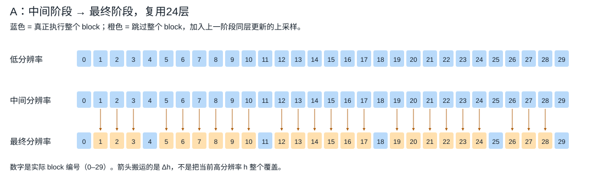
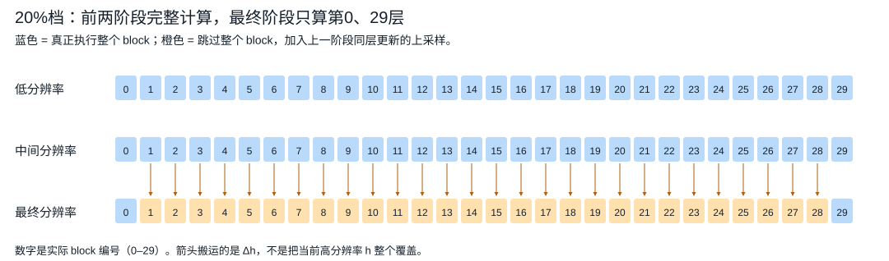
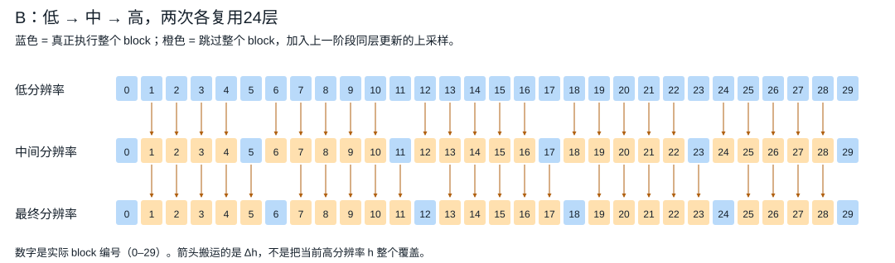
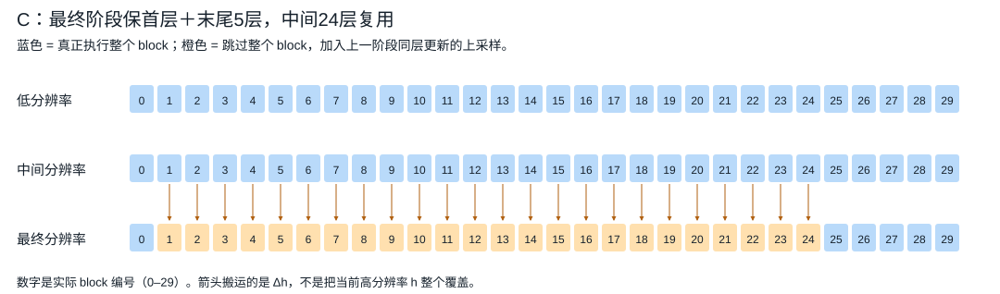

# RDD 跨分辨率残差复用：10%–50% 速度档位实测

> 新一轮：[真正三步图像 DMD 的两级复用微调与空间路径 20% 成本验证](RDD_DMD_CASCADE_FINETUNE_20260915_ZH.html)。A=8/20、B=16/18；两组已完成5000步，速度门槛通过但画质尚未达标，不是下文旧视频的训练后结果。

这里的“加速 20%”统一指 **采样＋真实 VAE 解码的延迟减少 20%**，即耗时变为 0.8 倍、吞吐意义上的速度为 1.25×；不是“去噪快20%”。

比较对象都是 **同尺寸、同分辨率路径的不复用 RDD + 原生 VSA20**。不与普通全分辨率生成混比。

重要限制：视频权重仍是未经过 RDD/复用微调的 FastWan。下列实验验证实现、实际时间和未经微调的可见破坏；**没有证明训练后视频质量，也没有正式 VBench/FVD**。

本轮已完成 11 个场景、44 个方法配置。

## 1. 推荐结论与画面检查
**结论：已经测试到约13%、21%、30%三个总延迟档，但只有前两个档位有值得继续训练的候选；30%版本画质明显不足，40%/50%没有找到可推荐的实测配置。** 不能承诺整网微调一定会把极端跳层修好。

以下都以同一场景的不复用RDD为基线；不是对普通full-resolution模型的加速。时间是采样＋VAE，不含MP4编码。

| 目标档 | 场景与实际配置 | 实测总延迟减少 | 我对当前画面的判断 | 建议 |
|---|---|---:|---|---|
| ≥10% | Temporal221，832×448×29；最终阶段均匀复用24/30层，s=1 | 狐狸12.97%；汽车12.95%；行人12.94% | 三个主体都保留，但首帧、车灯/车牌、雨衣纹理等有退化 | 优先训练；当前最有跨prompt证据的选择 |
| ≥10% | 同场景，最终24层复用，s=0.75 | 狐狸12.89%；汽车11.96%；行人11.60% | 狐狸比较干净，但没有证据证明0.75对所有prompt都优于1 | 保留作幅度对照，不称为普适最优 |
| ≥10% | 同场景，保留首层0＋末尾25–29，跳1–24 | 狐狸12.08%；s=0.75时12.49% | 狐狸结构和细节保留；尚仅一个prompt | 重点层位置对照；比直接跳0–23合理 |
| ≥10% | 同场景，最终复用28/30层，只算0和29 | 狐狸14.16%；汽车14.61%；行人13.96% | 比24层版本更激进，首帧和细节问题更明显 | 若12%不够，再试此项 |
| ≥20% | **Temporal221，1280×768×85；最终复用28/30层，s=1** | **20.72%**；32.988→26.161s | 狐狸/环境/总体运动姿态仍可辨认；首帧与皮毛明显变化。没有达到原版质量 | **20%档首选训练候选**；不等于即刻高质量部署 |
| ≥20% | Spatial221，1280×768×81；最终24层或28层复用 | 21.42% / 25.26% | 有明显网格/块状细节，主体虽在，质量比时间降采样版本差 | 备选压力测试，不优先于Temporal221 |
| ≥30% | Temporal421，832×448×253；中、最终阶段各复用28层 | **30.26%**；34.346→23.987s | 首帧块状破坏明显，后续仍有模糊/伪影 | 只证明速度；不列入“效果还行”的推荐 |
| ≥40% | 本轮没有合格配置 | 未达到 | — | 不凑数 |
| ≥50% | 本轮没有合格配置 | 未达到 | — | 不凑数 |

较大Temporal221的24层版本是 **17.75%**，没有达到20%；28层版本的四组分别为20.69%、20.74%、20.76%、20.69%。它只在这一输出尺寸和路径下达到20%，不是“复用28层永远快20%”。

### 这轮最重要的三个pattern

1. **是否保留首层非常重要。** 直接跳0–23与跳1–24都省24层，但前者明显碎块化，后者保住狐狸。保留首2＋尾4、首3＋尾3也保住主体，总延迟分别减少12.63%、11.92%。这支持保留早期条件处理；目前只在这一布局对照中验证，不能说第0层对所有模型永远不可跳。
2. **“低分辨率”是哪一种低，影响很大。** Temporal221的缓存仍有完整空间网格，只是帧数少；Spatial221则连空间细节也一起降采样。因此前者传过来的更新保留更多空间信息，是当前更合理的激进复用入口。这是结构上的解释与当前观察相符，不是对训练收敛的证明。
3. **中间阶段也复用，会把错误继续传下去。** 1280×768×61的Temporal421，两级28层复用只有28.94%，未达到30%，且画面比只复用最终阶段更糊。253帧才达到30.26%，但还是明显损伤。这不是同质量的加速胜利。

### 对视频的实际审阅范围

检查了每个方法的固定五帧（首帧、1/4、1/2、3/4、末帧），没有挑最好帧；页面保留全部原MP4供逐帧/连续播放。汽车、行人用于检查小视频配置是否只对狐狸有效。没有用这三段视频推算FID/FVD，也没有把像素接近当成正式画质评分。

**训练优先级：单次最终阶段复用24层 → 保首层的布局对照 → Temporal221最终28层 → 少量中间层复用。** 不建议直接从两级28层起步。推理速度已经能测，但视频权重本身仍需正确RDD路径适配与整网联合训练。

### 40%/50%为什么不能直接保证

253帧场景中，去噪约13.3s、总时间约34.4s。哪怕去噪完全消失，总时间也最多少约38.6%；而真正的复用还必须计算coarse阶段。1280×768×85的Temporal221虽然去噪占约42.4%，但前两次模型调用都必须执行，单靠最终阶段复用的理想上限仅约23%。所以当前20.72%已经接近这一配置的结构上限。

这不是说任何未来RDD系统都不可能快40%或50%，而是**本次同模型、同输出、同三次调用、同VAE的对照没有做到**。不能通过把基线换成FP32 VAE、偷偷多算采样步、拿不同输出尺寸相除来造出更高百分比。

### 平滑插值没有成为新的赢家

Spatial221中把内部残差搬运改成trilinear，24/28层版本的总延迟分别减少20.31%/23.66%。接缝有所软化，但脸与皮毛仍明显模糊，且没有比nearest版本更快。因此它保留为插值对照，不列为优先推荐，也没有改变noise filling边界。

## 2. 方法：究竟复用了哪里？

每个阶段仍然先做 patch embedding、时间/文字条件和位置编码；接着进入 **30 个 Transformer block**，最后用原输出头预测。

一个正常 block 包含自注意力（原生 VSA 的 fine/coarse 分支与 gate）、文字 cross-attention 和 MLP。正常执行时记下 **输出 hidden − 输入 hidden**，也就是这一层对输入作了什么更新。

在下一分辨率的选中层，不计算这个 block，改为：

$$h_{l+1}^{\mathrm{fine}}=h_l^{\mathrm{fine}}+s\,U(\Delta_l^{\mathrm{previous}}),\qquad \Delta_l=h_{l+1}-h_l.$$

`U` 是按 token 网格沿变化的空间/时间维度做 nearest 上采样；`s` 是更新强度。本轮试了1、0.75、0.5。**当前 fine hidden 保留**，只替换这一层的更新。执行的 native block 不删 VSA coarse output；被跳过 block 的 coarse output 已包含在旧 Δ 中，但不是当前 timestep 重新计算的结果。

这省下的是该层 QKV、注意力、cross-attention、MLP 等全部计算，不只是注意力矩阵。没有新 adapter，也没有偷偷改 VAE。模型权重在本轮测试中全部冻结；需要质量恢复时应训练整网。

### A. 只复用最终阶段：优先候选

低/中阶段完整执行，最终阶段选18/24/28层搬运中阶段更新。`fine24`是复用24层、保留6层，**不是只计算24层**。`fine28`只留首尾2层。

下面是20%档实际测试的28层版本：只有最终阶段的第0、29层真实计算。前两次调用仍完整执行，Temporal221中它们形状相同。

### B. 两次级联：更快，也更难训练

低阶段先完整算；中阶段复用低阶段选中层；最终阶段复用中阶段选中层。如果中阶段这一层也是复用的，那么最终阶段继承的是已转移过一次的更新。`cascade12_24`表示中阶段复用12层、最终复用24层。

`cascade28` 在中/最终阶段都只留 block0、29真实执行，是极端测试，不等于已达到可用画质。

### C. 改变真实计算放在哪里

`prefix24`直接跳0–23、只算24–29；`head1_tail5`跳1–24、保留首层0和末尾25–29；`head2_tail4`跳2–25；`head3_tail3`跳3–26。它们都跳24层，但保留的计算位置不同。

不要把“跳24层”当作足够的配置描述。是否跳首层、在哪些层读取当前文字/时间条件、是否在中间插入新计算，都可能改变效果。

### 内部残差上采样的平滑对照

另测了`spatial221_1280_81_trilinear`：仅把内部Δh的nearest搬运换成trilinear插值，噪声填充和采样边界完全不变。它是同一复用方法的插值配置，不是新VAE或新采样器。画面仍有明显细节损失，不能说平滑插值已经解决空间复用问题。

### D. 缓存实现与适用范围

只保存下一个阶段将要消费的层；读完即释放，最终阶段不再保留无用缓存。我们已在同输入下检查原缓存与短生命周期实现的 latent 精确一致。这个优化只改变内存寿命。

**当前视频控制器只支持每阶段一次调用**，即这次DMD 3NFE。不能直接拿去跑同stage90步：旧图像实现是整个fine阶段重复使用同一边界缓存，误差累积与本次视频不同。

## 3. 公平性、计时口径、为什么有些档位空着

所有配置：FastWan2.1-T2V-1.3B（加载约1.49B参数），30层，原生VSA保留20%，DMD三次调用`t=1000/757/522`，`noise_filling`，模型常驻GPU、TF32关闭、两边相同BF16 VAE。没有改采样NFE，没有新增蒸馏权重。

`(空间缩小倍数, 时间缩小倍数)`：Temporal221=`(1,2)→(1,2)→(1,1)`；Temporal421=`(1,4)→(1,2)→(1,1)`；Spatial221=`(2,1)→(2,1)→(1,1)`。这是latent的倍数，不能把29输出帧机械除2；具体latent见每个视频表。相同形状的前两次调用不被重新命名为跨分辨率复用。

每个方法先热身，再在同卡上按ABBA/BAAB交替跑完整轨迹；每次都实际VAE解码。表中时间是各臂中位数，百分比是**逐组配对延迟减少的平均值**，所以用两个四舍五入中位数算出的百分比可能略有差异。区间仅反映本次3–4个组的重采样，不能当作独立机器/大规模质量保证。

GPU0–3与已有训练共享，未停止他人任务。每进程显存上限约28.49GiB；1920×1024的61/125帧两次探测在本进程上限处退出，没有计时结果，不能记成速度0或正常完成。编码MP4、加载模型/T5、冷编译不计入采样＋VAE。

假设VAE不变，最乐观的上限（连去噪也全部删掉）是：

$$\text{总延迟最多减少}\leq\frac{T_{\mathrm{denoise}}}{T_{\mathrm{denoise}}+T_{\mathrm{VAE}}}.$$

真实方法还要计算最低分辨率与保留层，因此一定比这个上限低。不能把去噪60%写成总时间60%，也不能把832与1600两种输出横向混成同一比较。

## 4. 所有方法的实测时间

| 场景 | 配置 | 去噪：基线→方法(s) | 采样＋VAE：基线→方法(s) | 总延迟减少；组区间 | 去噪延迟减少 |
|---|---|---:|---:|---:|---:|
| spatial221_1280_81 | fine18 | 11.020→6.286 | 29.106→24.361 | 16.30%；[16.17, 16.39] | 43.01% |
| spatial221_1280_81 | fine24 | 11.000→4.699 | 29.095→22.783 | 21.42%；[20.83, 21.72] | 57.31% |
| spatial221_1280_81 | prefix24 | 10.994→4.699 | 29.068→22.765 | 21.43%；[20.77, 21.81] | 56.92% |
| spatial221_1280_81 | fine28 | 10.983→3.657 | 29.036→21.706 | 25.26%；[25.25, 25.28] | 66.74% |
| spatial221_1280_81 | fine24_s075 | 11.003→4.688 | 29.025→22.748 | 21.68%；[21.63, 21.75] | 57.44% |
| spatial221_1280_81_trilinear | fine24 | 10.370→4.591 | 28.450→22.672 | 20.31%；[20.21, 20.44] | 55.73% |
| spatial221_1280_81_trilinear | fine28 | 10.354→3.615 | 28.405→21.699 | 23.66%；[23.54, 23.77] | 65.07% |
| temporal221_1280_85 | fine24 | 14.035→8.187 | 32.980→27.149 | 17.75%；[17.72, 17.78] | 41.71% |
| temporal221_1280_85 | fine28 | 14.035→7.204 | 32.988→26.161 | 20.72%；[20.69, 20.75] | 48.67% |
| temporal221_832_29 | fine24 | 1.239→0.755 | 3.654→3.176 | 12.97%；[12.47, 13.51] | 38.30% |
| temporal221_832_29 | fine28 | 1.224→0.704 | 3.630→3.129 | 14.16%；[14.04, 14.37] | 43.15% |
| temporal221_832_29 | prefix18 | 1.223→0.913 | 3.641→3.307 | 9.23%；[8.58, 9.69] | 26.19% |
| temporal221_832_29 | prefix24 | 1.234→0.776 | 3.642→3.184 | 12.58%；[12.15, 13.04] | 36.17% |
| temporal221_832_29 | fine24_s075 | 1.246→0.771 | 3.659→3.182 | 12.89%；[12.85, 12.92] | 37.38% |
| temporal221_832_29 | prefix24_s075 | 1.231→0.751 | 3.631→3.170 | 12.77%；[12.48, 13.09] | 38.64% |
| temporal221_832_29 | fine24_s050 | 1.223→0.767 | 3.609→3.186 | 11.92%；[11.37, 12.43] | 37.61% |
| temporal221_832_29_car | fine24 | 1.262→0.775 | 3.679→3.185 | 12.95%；[12.49, 13.34] | 36.92% |
| temporal221_832_29_car | fine24_s075 | 1.234→0.801 | 3.650→3.219 | 11.96%；[11.63, 12.37] | 35.58% |
| temporal221_832_29_car | fine28 | 1.223→0.720 | 3.636→3.113 | 14.61%；[14.33, 14.90] | 41.74% |
| temporal221_832_29_head_controls | head1_tail5 | 1.223→0.789 | 3.633→3.190 | 12.08%；[11.69, 12.29] | 35.73% |
| temporal221_832_29_head_controls | head2_tail4 | 1.207→0.774 | 3.619→3.178 | 12.63%；[11.81, 13.90] | 40.30% |
| temporal221_832_29_head_controls | head3_tail3 | 1.218→0.795 | 3.628→3.190 | 11.92%；[11.65, 12.33] | 35.28% |
| temporal221_832_29_head_controls | head1_tail5_s075 | 1.225→0.790 | 3.636→3.175 | 12.49%；[12.24, 12.73] | 36.26% |
| temporal221_832_29_person | fine24 | 1.260→0.769 | 3.658→3.179 | 12.94%；[12.49, 13.40] | 38.13% |
| temporal221_832_29_person | fine24_s075 | 1.237→0.815 | 3.648→3.220 | 11.60%；[11.25, 11.93] | 33.93% |
| temporal221_832_29_person | fine28 | 1.225→0.738 | 3.644→3.130 | 13.96%；[13.40, 14.76] | 40.72% |
| temporal421_1280_61 | fine24 | 8.018→4.322 | 21.632→17.923 | 17.15%；[17.12, 17.18] | 46.11% |
| temporal421_1280_61 | cascade12_24 | 8.002→3.458 | 21.625→17.083 | 20.98%；[20.76, 21.17] | 56.65% |
| temporal421_1280_61 | cascade18_24 | 7.986→3.057 | 21.596→16.671 | 23.81%；[22.65, 25.88] | 63.38% |
| temporal421_1280_61 | cascade24 | 7.968→2.645 | 21.571→16.247 | 24.72%；[24.69, 24.77] | 66.85% |
| temporal421_1280_61 | cascade_prefix18_24 | 7.970→3.048 | 21.572→16.642 | 22.86%；[22.79, 22.99] | 61.82% |
| temporal421_1280_61 | cascade28 | 7.971→1.725 | 21.577→15.336 | 28.94%；[28.87, 29.04] | 78.35% |
| temporal421_1600_61 | fine24 | 12.615→6.669 | 51.942→45.986 | 11.40%；[10.51, 12.08] | 47.15% |
| temporal421_1600_61 | cascade24 | 12.645→4.169 | 51.542→43.058 | 16.35%；[15.45, 17.05] | 66.96% |
| temporal421_1600_61 | cascade28 | 12.654→2.783 | 51.860→42.044 | 19.21%；[18.29, 20.13] | 78.06% |
| temporal421_832_253 | fine24 | 13.321→7.013 | 34.401→28.076 | 18.45%；[18.37, 18.50] | 47.56% |
| temporal421_832_253 | cascade24 | 13.286→4.326 | 34.372→25.405 | 26.02%；[25.97, 26.08] | 67.31% |
| temporal421_832_253 | cascade28 | 13.273→2.901 | 34.346→23.987 | 30.26%；[30.14, 30.34] | 78.34% |
| temporal421_832_29 | fine24 | 1.153→0.717 | 3.568→3.128 | 12.40%；[12.01, 13.14] | 38.29% |
| temporal421_832_29 | cascade12_24 | 1.179→0.610 | 3.571→3.033 | 15.41%；[15.25, 15.59] | 48.04% |
| temporal421_832_29 | cascade18_24 | 1.176→0.537 | 3.576→2.954 | 17.39%；[16.38, 18.14] | 54.01% |
| temporal421_832_29 | cascade24 | 1.149→0.504 | 3.566→2.912 | 18.50%；[18.29, 18.74] | 56.86% |
| temporal421_832_29 | cascade_prefix18_24 | 1.180→0.539 | 3.581→2.937 | 17.90%；[17.51, 18.14] | 54.39% |
| temporal421_832_29 | cascade28 | 1.169→0.387 | 3.577→2.784 | 22.20%；[21.61, 22.66] | 67.62% |

## 5. 如何训练，而不是继续盲目加大复用

**本轮没有新增训练，以下是下一轮实验计划，不是已经得到的质量。** 首先必须有不复用的RDD视频基线，或先完成FastWan→RDD路径适配。原FastWan权重不等于已经学习RDD drift 的teacher；不能把其低分辨率输出直接当成正确RDD监督。

1. **从A开始，训练整个backbone。** 冻结T5和VAE，保留共享参数；计算coarse更新时不能detach，让fine误差能反传给产生coarse更新的网络。首选24层的保首层/均匀布局；28层和级联先作压力测试。

实现上还有一步不能省：本轮视频控制器是inference-only，缓存用了detach。真正训练必须改为保留计算图的student路径，并用activation checkpointing重算；不能仅把当前控制器切到train模式。图像DirectReuseStudent已有不detach的实现，但视频版尚未完成这种训练验证。

2. **训练时就运行真实复用路径。** 用student真实coarse→middle→fine状态；冻结的正确RDD teacher也在这些student输入上给出监督，而不只使用预存teacher轨迹输入。这用于减少“训练见到的状态”和“采样实际进入的状态”不一致。

3. **同时保护各stage。** 保留原生RDD目标，并给低、中、最终阶段都加teacher保持损失。若是多步图像模型，覆盖整个stage时间范围，不是仅t600/t300两个边界；若是本次3步视频，覆盖实际三个调用及适度邻域。建议先用等权stage蒸馏，避免只优化fine误差毁掉coarse。

4. **渐进加大难度。** 先只复用最终阶段12→18→24层，再试中阶段6→12层＋最终24层。每次只有在独立prompt/seed上恢复质量才升级；不要默认训练更久必然能修好28/30层。最终可增加native block的间隔分布或首尾保留数。

5. **起步参数（待验证）**：BF16混合精度，AdamW学习率5e-6到1e-5、weight_decay0.01、梯度裁剪1；视频每卡1个样本，4卡梯度累计到global batch16起步；activation checkpointing。先500–1000更新检查损失/样片，再决定5K/20K，不预承诺收敛。图像可沿用原全局256，但必须修复teacher-input分布和coarse全时域保持。

共享显卡环境下，整网视频训练应先验证FSDP/optimizer-state sharding的一步通信和显存，再从29帧起步；本轮采样显存通过不代表整网Adam状态与反向激活也能装下。scale=0.75的部署配置也应在训练时用0.75，不把不同配置混为一谈。

6. **需要怎样的证据**：固定未训练prompt/seed，比较同一RDD baseline的文本一致性、运动/闪烁、细节、人脸与肢体；再扩大到VBench/FVD或适合的正式评估。最终速度也必须用训练后权重重测。当前几段狐狸/汽车/行人不能替代此步骤。

速度目标不是质量保证：10%档优先训练单次fine复用；20%档先保住单次fine，再尝试少量middle复用；30%及以上若只能靠极端级联才达到，就必须把它当作高风险结构压缩，而不是现成推荐。

## 6. 全部视频：按场景放在同一个对比组

### spatial221_1280_81

Prompt：A red fox walking through a snowy forest, cinematic natural light.；seed=20660913。

#### baseline

<video controls preload="none" poster="../../eval_results/reuse_latency_tiers_20260915/spatial221_1280_81/baseline.png" src="../../eval_results/reuse_latency_tiers_20260915/spatial221_1280_81/baseline.mp4" style="width:100%;max-width:900px"></video>

| 配置 | 取值 |
|---|---|
| 输出 | 1280×768×81帧，16fps，5.06s |
| latent（T×H×W） | 21×48×80 → 21×48×80 → 21×96×160 |
| factors（空间,时间） | [[2, 1], [2, 1], [1, 1]] |
| 复用层（0-based） | 无 |
| 保留真实层 | 全部stage的全部30层真实执行 |
| 更新强度s | 1.0 |
| 内部残差上采样 | nearest；不改变noise_filling边界 |
| 采样与后端 | DMD3NFE，1000/757/522；noise_filling；native VSA20；相同BF16 VAE |
| 时间基准 | 每个方法都有独立ABBA基线；对应精确时间见总表，不用单次展示调用代替基线 |
| 原始记录 | [metrics.json](../../eval_results/reuse_latency_tiers_20260915/spatial221_1280_81/metrics.json) |

#### fine18

<video controls preload="none" poster="../../eval_results/reuse_latency_tiers_20260915/spatial221_1280_81/fine18.png" src="../../eval_results/reuse_latency_tiers_20260915/spatial221_1280_81/fine18.mp4" style="width:100%;max-width:900px"></video>

| 配置 | 取值 |
|---|---|
| 输出 | 1280×768×81帧，16fps，5.06s |
| latent（T×H×W） | 21×48×80 → 21×48×80 → 21×96×160 |
| factors（空间,时间） | [[2, 1], [2, 1], [1, 1]] |
| 复用层（0-based） | {'2': [1, 3, 4, 6, 7, 9, 11, 12, 14, 15, 17, 18, 20, 22, 23, 25, 26, 28]} |
| 保留真实层 | stage2真实层=[0, 2, 5, 8, 10, 13, 16, 19, 21, 24, 27, 29] |
| 更新强度s | 1.0 |
| 内部残差上采样 | nearest；不改变noise_filling边界 |
| 采样与后端 | DMD3NFE，1000/757/522；noise_filling；native VSA20；相同BF16 VAE |
| 去噪 | 6.286s；配对减少43.01%；1.755× |
| 采样＋VAE | 24.361s；配对减少16.30%；1.195× |
| 原始记录 | [metrics.json](../../eval_results/reuse_latency_tiers_20260915/spatial221_1280_81/metrics.json) |

#### fine24

<video controls preload="none" poster="../../eval_results/reuse_latency_tiers_20260915/spatial221_1280_81/fine24.png" src="../../eval_results/reuse_latency_tiers_20260915/spatial221_1280_81/fine24.mp4" style="width:100%;max-width:900px"></video>

| 配置 | 取值 |
|---|---|
| 输出 | 1280×768×81帧，16fps，5.06s |
| latent（T×H×W） | 21×48×80 → 21×48×80 → 21×96×160 |
| factors（空间,时间） | [[2, 1], [2, 1], [1, 1]] |
| 复用层（0-based） | {'2': [1, 2, 3, 5, 6, 7, 8, 9, 10, 12, 13, 14, 15, 16, 17, 19, 20, 21, 22, 23, 24, 26, 27, 28]} |
| 保留真实层 | stage2真实层=[0, 4, 11, 18, 25, 29] |
| 更新强度s | 1.0 |
| 内部残差上采样 | nearest；不改变noise_filling边界 |
| 采样与后端 | DMD3NFE，1000/757/522；noise_filling；native VSA20；相同BF16 VAE |
| 去噪 | 4.699s；配对减少57.31%；2.343× |
| 采样＋VAE | 22.783s；配对减少21.42%；1.273× |
| 原始记录 | [metrics.json](../../eval_results/reuse_latency_tiers_20260915/spatial221_1280_81/metrics.json) |

#### prefix24

<video controls preload="none" poster="../../eval_results/reuse_latency_tiers_20260915/spatial221_1280_81/prefix24.png" src="../../eval_results/reuse_latency_tiers_20260915/spatial221_1280_81/prefix24.mp4" style="width:100%;max-width:900px"></video>

| 配置 | 取值 |
|---|---|
| 输出 | 1280×768×81帧，16fps，5.06s |
| latent（T×H×W） | 21×48×80 → 21×48×80 → 21×96×160 |
| factors（空间,时间） | [[2, 1], [2, 1], [1, 1]] |
| 复用层（0-based） | {'2': [0, 1, 2, 3, 4, 5, 6, 7, 8, 9, 10, 11, 12, 13, 14, 15, 16, 17, 18, 19, 20, 21, 22, 23]} |
| 保留真实层 | stage2真实层=[24, 25, 26, 27, 28, 29] |
| 更新强度s | 1.0 |
| 内部残差上采样 | nearest；不改变noise_filling边界 |
| 采样与后端 | DMD3NFE，1000/757/522；noise_filling；native VSA20；相同BF16 VAE |
| 去噪 | 4.699s；配对减少56.92%；2.321× |
| 采样＋VAE | 22.765s；配对减少21.43%；1.273× |
| 原始记录 | [metrics.json](../../eval_results/reuse_latency_tiers_20260915/spatial221_1280_81/metrics.json) |

#### fine28

<video controls preload="none" poster="../../eval_results/reuse_latency_tiers_20260915/spatial221_1280_81/fine28.png" src="../../eval_results/reuse_latency_tiers_20260915/spatial221_1280_81/fine28.mp4" style="width:100%;max-width:900px"></video>

| 配置 | 取值 |
|---|---|
| 输出 | 1280×768×81帧，16fps，5.06s |
| latent（T×H×W） | 21×48×80 → 21×48×80 → 21×96×160 |
| factors（空间,时间） | [[2, 1], [2, 1], [1, 1]] |
| 复用层（0-based） | {'2': [1, 2, 3, 4, 5, 6, 7, 8, 9, 10, 11, 12, 13, 14, 15, 16, 17, 18, 19, 20, 21, 22, 23, 24, 25, 26, 27, 28]} |
| 保留真实层 | stage2真实层=[0, 29] |
| 更新强度s | 1.0 |
| 内部残差上采样 | nearest；不改变noise_filling边界 |
| 采样与后端 | DMD3NFE，1000/757/522；noise_filling；native VSA20；相同BF16 VAE |
| 去噪 | 3.657s；配对减少66.74%；3.006× |
| 采样＋VAE | 21.706s；配对减少25.26%；1.338× |
| 原始记录 | [metrics.json](../../eval_results/reuse_latency_tiers_20260915/spatial221_1280_81/metrics.json) |

#### fine24_s075

<video controls preload="none" poster="../../eval_results/reuse_latency_tiers_20260915/spatial221_1280_81/fine24_s075.png" src="../../eval_results/reuse_latency_tiers_20260915/spatial221_1280_81/fine24_s075.mp4" style="width:100%;max-width:900px"></video>

| 配置 | 取值 |
|---|---|
| 输出 | 1280×768×81帧，16fps，5.06s |
| latent（T×H×W） | 21×48×80 → 21×48×80 → 21×96×160 |
| factors（空间,时间） | [[2, 1], [2, 1], [1, 1]] |
| 复用层（0-based） | {'2': [1, 2, 3, 5, 6, 7, 8, 9, 10, 12, 13, 14, 15, 16, 17, 19, 20, 21, 22, 23, 24, 26, 27, 28]} |
| 保留真实层 | stage2真实层=[0, 4, 11, 18, 25, 29] |
| 更新强度s | 0.75 |
| 内部残差上采样 | nearest；不改变noise_filling边界 |
| 采样与后端 | DMD3NFE，1000/757/522；noise_filling；native VSA20；相同BF16 VAE |
| 去噪 | 4.688s；配对减少57.44%；2.350× |
| 采样＋VAE | 22.748s；配对减少21.68%；1.277× |
| 原始记录 | [metrics.json](../../eval_results/reuse_latency_tiers_20260915/spatial221_1280_81/metrics.json) |

### spatial221_1280_81_trilinear

Prompt：A red fox walking through a snowy forest, cinematic natural light.；seed=20660913。

#### baseline

<video controls preload="none" poster="../../eval_results/reuse_latency_tiers_20260915/spatial221_1280_81_trilinear/baseline.png" src="../../eval_results/reuse_latency_tiers_20260915/spatial221_1280_81_trilinear/baseline.mp4" style="width:100%;max-width:900px"></video>

| 配置 | 取值 |
|---|---|
| 输出 | 1280×768×81帧，16fps，5.06s |
| latent（T×H×W） | 21×48×80 → 21×48×80 → 21×96×160 |
| factors（空间,时间） | [[2, 1], [2, 1], [1, 1]] |
| 复用层（0-based） | 无 |
| 保留真实层 | 全部stage的全部30层真实执行 |
| 更新强度s | 1.0 |
| 内部残差上采样 | trilinear；不改变noise_filling边界 |
| 采样与后端 | DMD3NFE，1000/757/522；noise_filling；native VSA20；相同BF16 VAE |
| 时间基准 | 每个方法都有独立ABBA基线；对应精确时间见总表，不用单次展示调用代替基线 |
| 原始记录 | [metrics.json](../../eval_results/reuse_latency_tiers_20260915/spatial221_1280_81_trilinear/metrics.json) |

#### fine24

<video controls preload="none" poster="../../eval_results/reuse_latency_tiers_20260915/spatial221_1280_81_trilinear/fine24.png" src="../../eval_results/reuse_latency_tiers_20260915/spatial221_1280_81_trilinear/fine24.mp4" style="width:100%;max-width:900px"></video>

| 配置 | 取值 |
|---|---|
| 输出 | 1280×768×81帧，16fps，5.06s |
| latent（T×H×W） | 21×48×80 → 21×48×80 → 21×96×160 |
| factors（空间,时间） | [[2, 1], [2, 1], [1, 1]] |
| 复用层（0-based） | {'2': [1, 2, 3, 5, 6, 7, 8, 9, 10, 12, 13, 14, 15, 16, 17, 19, 20, 21, 22, 23, 24, 26, 27, 28]} |
| 保留真实层 | stage2真实层=[0, 4, 11, 18, 25, 29] |
| 更新强度s | 1.0 |
| 内部残差上采样 | trilinear；不改变noise_filling边界 |
| 采样与后端 | DMD3NFE，1000/757/522；noise_filling；native VSA20；相同BF16 VAE |
| 去噪 | 4.591s；配对减少55.73%；2.259× |
| 采样＋VAE | 22.672s；配对减少20.31%；1.255× |
| 原始记录 | [metrics.json](../../eval_results/reuse_latency_tiers_20260915/spatial221_1280_81_trilinear/metrics.json) |

#### fine28

<video controls preload="none" poster="../../eval_results/reuse_latency_tiers_20260915/spatial221_1280_81_trilinear/fine28.png" src="../../eval_results/reuse_latency_tiers_20260915/spatial221_1280_81_trilinear/fine28.mp4" style="width:100%;max-width:900px"></video>

| 配置 | 取值 |
|---|---|
| 输出 | 1280×768×81帧，16fps，5.06s |
| latent（T×H×W） | 21×48×80 → 21×48×80 → 21×96×160 |
| factors（空间,时间） | [[2, 1], [2, 1], [1, 1]] |
| 复用层（0-based） | {'2': [1, 2, 3, 4, 5, 6, 7, 8, 9, 10, 11, 12, 13, 14, 15, 16, 17, 18, 19, 20, 21, 22, 23, 24, 25, 26, 27, 28]} |
| 保留真实层 | stage2真实层=[0, 29] |
| 更新强度s | 1.0 |
| 内部残差上采样 | trilinear；不改变noise_filling边界 |
| 采样与后端 | DMD3NFE，1000/757/522；noise_filling；native VSA20；相同BF16 VAE |
| 去噪 | 3.615s；配对减少65.07%；2.863× |
| 采样＋VAE | 21.699s；配对减少23.66%；1.310× |
| 原始记录 | [metrics.json](../../eval_results/reuse_latency_tiers_20260915/spatial221_1280_81_trilinear/metrics.json) |

### temporal221_1280_85

Prompt：A red fox walking through a snowy forest, cinematic natural light.；seed=20660913。

#### baseline

<video controls preload="none" poster="../../eval_results/reuse_latency_tiers_20260915/temporal221_1280_85/baseline.png" src="../../eval_results/reuse_latency_tiers_20260915/temporal221_1280_85/baseline.mp4" style="width:100%;max-width:900px"></video>

| 配置 | 取值 |
|---|---|
| 输出 | 1280×768×85帧，16fps，5.31s |
| latent（T×H×W） | 11×96×160 → 11×96×160 → 22×96×160 |
| factors（空间,时间） | [[1, 2], [1, 2], [1, 1]] |
| 复用层（0-based） | 无 |
| 保留真实层 | 全部stage的全部30层真实执行 |
| 更新强度s | 1.0 |
| 内部残差上采样 | nearest；不改变noise_filling边界 |
| 采样与后端 | DMD3NFE，1000/757/522；noise_filling；native VSA20；相同BF16 VAE |
| 时间基准 | 每个方法都有独立ABBA基线；对应精确时间见总表，不用单次展示调用代替基线 |
| 原始记录 | [metrics.json](../../eval_results/reuse_latency_tiers_20260915/temporal221_1280_85/metrics.json) |

#### fine24

<video controls preload="none" poster="../../eval_results/reuse_latency_tiers_20260915/temporal221_1280_85/fine24.png" src="../../eval_results/reuse_latency_tiers_20260915/temporal221_1280_85/fine24.mp4" style="width:100%;max-width:900px"></video>

| 配置 | 取值 |
|---|---|
| 输出 | 1280×768×85帧，16fps，5.31s |
| latent（T×H×W） | 11×96×160 → 11×96×160 → 22×96×160 |
| factors（空间,时间） | [[1, 2], [1, 2], [1, 1]] |
| 复用层（0-based） | {'2': [1, 2, 3, 5, 6, 7, 8, 9, 10, 12, 13, 14, 15, 16, 17, 19, 20, 21, 22, 23, 24, 26, 27, 28]} |
| 保留真实层 | stage2真实层=[0, 4, 11, 18, 25, 29] |
| 更新强度s | 1.0 |
| 内部残差上采样 | nearest；不改变noise_filling边界 |
| 采样与后端 | DMD3NFE，1000/757/522；noise_filling；native VSA20；相同BF16 VAE |
| 去噪 | 8.187s；配对减少41.71%；1.716× |
| 采样＋VAE | 27.149s；配对减少17.75%；1.216× |
| 原始记录 | [metrics.json](../../eval_results/reuse_latency_tiers_20260915/temporal221_1280_85/metrics.json) |

#### fine28

<video controls preload="none" poster="../../eval_results/reuse_latency_tiers_20260915/temporal221_1280_85/fine28.png" src="../../eval_results/reuse_latency_tiers_20260915/temporal221_1280_85/fine28.mp4" style="width:100%;max-width:900px"></video>

| 配置 | 取值 |
|---|---|
| 输出 | 1280×768×85帧，16fps，5.31s |
| latent（T×H×W） | 11×96×160 → 11×96×160 → 22×96×160 |
| factors（空间,时间） | [[1, 2], [1, 2], [1, 1]] |
| 复用层（0-based） | {'2': [1, 2, 3, 4, 5, 6, 7, 8, 9, 10, 11, 12, 13, 14, 15, 16, 17, 18, 19, 20, 21, 22, 23, 24, 25, 26, 27, 28]} |
| 保留真实层 | stage2真实层=[0, 29] |
| 更新强度s | 1.0 |
| 内部残差上采样 | nearest；不改变noise_filling边界 |
| 采样与后端 | DMD3NFE，1000/757/522；noise_filling；native VSA20；相同BF16 VAE |
| 去噪 | 7.204s；配对减少48.67%；1.948× |
| 采样＋VAE | 26.161s；配对减少20.72%；1.261× |
| 原始记录 | [metrics.json](../../eval_results/reuse_latency_tiers_20260915/temporal221_1280_85/metrics.json) |

### temporal221_832_29

Prompt：A red fox walking through a snowy forest, cinematic natural light.；seed=20660913。

#### baseline

<video controls preload="none" poster="../../eval_results/reuse_latency_tiers_20260915/temporal221_832_29/baseline.png" src="../../eval_results/reuse_latency_tiers_20260915/temporal221_832_29/baseline.mp4" style="width:100%;max-width:900px"></video>

| 配置 | 取值 |
|---|---|
| 输出 | 832×448×29帧，16fps，1.81s |
| latent（T×H×W） | 4×56×104 → 4×56×104 → 8×56×104 |
| factors（空间,时间） | [[1, 2], [1, 2], [1, 1]] |
| 复用层（0-based） | 无 |
| 保留真实层 | 全部stage的全部30层真实执行 |
| 更新强度s | 1.0 |
| 内部残差上采样 | nearest；不改变noise_filling边界 |
| 采样与后端 | DMD3NFE，1000/757/522；noise_filling；native VSA20；相同BF16 VAE |
| 时间基准 | 每个方法都有独立ABBA基线；对应精确时间见总表，不用单次展示调用代替基线 |
| 原始记录 | [metrics.json](../../eval_results/reuse_latency_tiers_20260915/temporal221_832_29/metrics.json) |

#### fine24

<video controls preload="none" poster="../../eval_results/reuse_latency_tiers_20260915/temporal221_832_29/fine24.png" src="../../eval_results/reuse_latency_tiers_20260915/temporal221_832_29/fine24.mp4" style="width:100%;max-width:900px"></video>

| 配置 | 取值 |
|---|---|
| 输出 | 832×448×29帧，16fps，1.81s |
| latent（T×H×W） | 4×56×104 → 4×56×104 → 8×56×104 |
| factors（空间,时间） | [[1, 2], [1, 2], [1, 1]] |
| 复用层（0-based） | {'2': [1, 2, 3, 5, 6, 7, 8, 9, 10, 12, 13, 14, 15, 16, 17, 19, 20, 21, 22, 23, 24, 26, 27, 28]} |
| 保留真实层 | stage2真实层=[0, 4, 11, 18, 25, 29] |
| 更新强度s | 1.0 |
| 内部残差上采样 | nearest；不改变noise_filling边界 |
| 采样与后端 | DMD3NFE，1000/757/522；noise_filling；native VSA20；相同BF16 VAE |
| 去噪 | 0.755s；配对减少38.30%；1.621× |
| 采样＋VAE | 3.176s；配对减少12.97%；1.149× |
| 原始记录 | [metrics.json](../../eval_results/reuse_latency_tiers_20260915/temporal221_832_29/metrics.json) |

#### fine28

<video controls preload="none" poster="../../eval_results/reuse_latency_tiers_20260915/temporal221_832_29/fine28.png" src="../../eval_results/reuse_latency_tiers_20260915/temporal221_832_29/fine28.mp4" style="width:100%;max-width:900px"></video>

| 配置 | 取值 |
|---|---|
| 输出 | 832×448×29帧，16fps，1.81s |
| latent（T×H×W） | 4×56×104 → 4×56×104 → 8×56×104 |
| factors（空间,时间） | [[1, 2], [1, 2], [1, 1]] |
| 复用层（0-based） | {'2': [1, 2, 3, 4, 5, 6, 7, 8, 9, 10, 11, 12, 13, 14, 15, 16, 17, 18, 19, 20, 21, 22, 23, 24, 25, 26, 27, 28]} |
| 保留真实层 | stage2真实层=[0, 29] |
| 更新强度s | 1.0 |
| 内部残差上采样 | nearest；不改变noise_filling边界 |
| 采样与后端 | DMD3NFE，1000/757/522；noise_filling；native VSA20；相同BF16 VAE |
| 去噪 | 0.704s；配对减少43.15%；1.759× |
| 采样＋VAE | 3.129s；配对减少14.16%；1.165× |
| 原始记录 | [metrics.json](../../eval_results/reuse_latency_tiers_20260915/temporal221_832_29/metrics.json) |

#### prefix18

<video controls preload="none" poster="../../eval_results/reuse_latency_tiers_20260915/temporal221_832_29/prefix18.png" src="../../eval_results/reuse_latency_tiers_20260915/temporal221_832_29/prefix18.mp4" style="width:100%;max-width:900px"></video>

| 配置 | 取值 |
|---|---|
| 输出 | 832×448×29帧，16fps，1.81s |
| latent（T×H×W） | 4×56×104 → 4×56×104 → 8×56×104 |
| factors（空间,时间） | [[1, 2], [1, 2], [1, 1]] |
| 复用层（0-based） | {'2': [0, 1, 2, 3, 4, 5, 6, 7, 8, 9, 10, 11, 12, 13, 14, 15, 16, 17]} |
| 保留真实层 | stage2真实层=[18, 19, 20, 21, 22, 23, 24, 25, 26, 27, 28, 29] |
| 更新强度s | 1.0 |
| 内部残差上采样 | nearest；不改变noise_filling边界 |
| 采样与后端 | DMD3NFE，1000/757/522；noise_filling；native VSA20；相同BF16 VAE |
| 去噪 | 0.913s；配对减少26.19%；1.355× |
| 采样＋VAE | 3.307s；配对减少9.23%；1.102× |
| 原始记录 | [metrics.json](../../eval_results/reuse_latency_tiers_20260915/temporal221_832_29/metrics.json) |

#### prefix24

<video controls preload="none" poster="../../eval_results/reuse_latency_tiers_20260915/temporal221_832_29/prefix24.png" src="../../eval_results/reuse_latency_tiers_20260915/temporal221_832_29/prefix24.mp4" style="width:100%;max-width:900px"></video>

| 配置 | 取值 |
|---|---|
| 输出 | 832×448×29帧，16fps，1.81s |
| latent（T×H×W） | 4×56×104 → 4×56×104 → 8×56×104 |
| factors（空间,时间） | [[1, 2], [1, 2], [1, 1]] |
| 复用层（0-based） | {'2': [0, 1, 2, 3, 4, 5, 6, 7, 8, 9, 10, 11, 12, 13, 14, 15, 16, 17, 18, 19, 20, 21, 22, 23]} |
| 保留真实层 | stage2真实层=[24, 25, 26, 27, 28, 29] |
| 更新强度s | 1.0 |
| 内部残差上采样 | nearest；不改变noise_filling边界 |
| 采样与后端 | DMD3NFE，1000/757/522；noise_filling；native VSA20；相同BF16 VAE |
| 去噪 | 0.776s；配对减少36.17%；1.567× |
| 采样＋VAE | 3.184s；配对减少12.58%；1.144× |
| 原始记录 | [metrics.json](../../eval_results/reuse_latency_tiers_20260915/temporal221_832_29/metrics.json) |

#### fine24_s075

<video controls preload="none" poster="../../eval_results/reuse_latency_tiers_20260915/temporal221_832_29/fine24_s075.png" src="../../eval_results/reuse_latency_tiers_20260915/temporal221_832_29/fine24_s075.mp4" style="width:100%;max-width:900px"></video>

| 配置 | 取值 |
|---|---|
| 输出 | 832×448×29帧，16fps，1.81s |
| latent（T×H×W） | 4×56×104 → 4×56×104 → 8×56×104 |
| factors（空间,时间） | [[1, 2], [1, 2], [1, 1]] |
| 复用层（0-based） | {'2': [1, 2, 3, 5, 6, 7, 8, 9, 10, 12, 13, 14, 15, 16, 17, 19, 20, 21, 22, 23, 24, 26, 27, 28]} |
| 保留真实层 | stage2真实层=[0, 4, 11, 18, 25, 29] |
| 更新强度s | 0.75 |
| 内部残差上采样 | nearest；不改变noise_filling边界 |
| 采样与后端 | DMD3NFE，1000/757/522；noise_filling；native VSA20；相同BF16 VAE |
| 去噪 | 0.771s；配对减少37.38%；1.597× |
| 采样＋VAE | 3.182s；配对减少12.89%；1.148× |
| 原始记录 | [metrics.json](../../eval_results/reuse_latency_tiers_20260915/temporal221_832_29/metrics.json) |

#### prefix24_s075

<video controls preload="none" poster="../../eval_results/reuse_latency_tiers_20260915/temporal221_832_29/prefix24_s075.png" src="../../eval_results/reuse_latency_tiers_20260915/temporal221_832_29/prefix24_s075.mp4" style="width:100%;max-width:900px"></video>

| 配置 | 取值 |
|---|---|
| 输出 | 832×448×29帧，16fps，1.81s |
| latent（T×H×W） | 4×56×104 → 4×56×104 → 8×56×104 |
| factors（空间,时间） | [[1, 2], [1, 2], [1, 1]] |
| 复用层（0-based） | {'2': [0, 1, 2, 3, 4, 5, 6, 7, 8, 9, 10, 11, 12, 13, 14, 15, 16, 17, 18, 19, 20, 21, 22, 23]} |
| 保留真实层 | stage2真实层=[24, 25, 26, 27, 28, 29] |
| 更新强度s | 0.75 |
| 内部残差上采样 | nearest；不改变noise_filling边界 |
| 采样与后端 | DMD3NFE，1000/757/522；noise_filling；native VSA20；相同BF16 VAE |
| 去噪 | 0.751s；配对减少38.64%；1.630× |
| 采样＋VAE | 3.170s；配对减少12.77%；1.146× |
| 原始记录 | [metrics.json](../../eval_results/reuse_latency_tiers_20260915/temporal221_832_29/metrics.json) |

#### fine24_s050

<video controls preload="none" poster="../../eval_results/reuse_latency_tiers_20260915/temporal221_832_29/fine24_s050.png" src="../../eval_results/reuse_latency_tiers_20260915/temporal221_832_29/fine24_s050.mp4" style="width:100%;max-width:900px"></video>

| 配置 | 取值 |
|---|---|
| 输出 | 832×448×29帧，16fps，1.81s |
| latent（T×H×W） | 4×56×104 → 4×56×104 → 8×56×104 |
| factors（空间,时间） | [[1, 2], [1, 2], [1, 1]] |
| 复用层（0-based） | {'2': [1, 2, 3, 5, 6, 7, 8, 9, 10, 12, 13, 14, 15, 16, 17, 19, 20, 21, 22, 23, 24, 26, 27, 28]} |
| 保留真实层 | stage2真实层=[0, 4, 11, 18, 25, 29] |
| 更新强度s | 0.5 |
| 内部残差上采样 | nearest；不改变noise_filling边界 |
| 采样与后端 | DMD3NFE，1000/757/522；noise_filling；native VSA20；相同BF16 VAE |
| 去噪 | 0.767s；配对减少37.61%；1.603× |
| 采样＋VAE | 3.186s；配对减少11.92%；1.135× |
| 原始记录 | [metrics.json](../../eval_results/reuse_latency_tiers_20260915/temporal221_832_29/metrics.json) |

### temporal221_832_29_car

Prompt：A red sports car driving along a coastal road, ocean waves and cliffs, realistic cinematic tracking shot.；seed=20660914。

#### baseline

<video controls preload="none" poster="../../eval_results/reuse_latency_tiers_20260915/temporal221_832_29_car/baseline.png" src="../../eval_results/reuse_latency_tiers_20260915/temporal221_832_29_car/baseline.mp4" style="width:100%;max-width:900px"></video>

| 配置 | 取值 |
|---|---|
| 输出 | 832×448×29帧，16fps，1.81s |
| latent（T×H×W） | 4×56×104 → 4×56×104 → 8×56×104 |
| factors（空间,时间） | [[1, 2], [1, 2], [1, 1]] |
| 复用层（0-based） | 无 |
| 保留真实层 | 全部stage的全部30层真实执行 |
| 更新强度s | 1.0 |
| 内部残差上采样 | nearest；不改变noise_filling边界 |
| 采样与后端 | DMD3NFE，1000/757/522；noise_filling；native VSA20；相同BF16 VAE |
| 时间基准 | 每个方法都有独立ABBA基线；对应精确时间见总表，不用单次展示调用代替基线 |
| 原始记录 | [metrics.json](../../eval_results/reuse_latency_tiers_20260915/temporal221_832_29_car/metrics.json) |

#### fine24

<video controls preload="none" poster="../../eval_results/reuse_latency_tiers_20260915/temporal221_832_29_car/fine24.png" src="../../eval_results/reuse_latency_tiers_20260915/temporal221_832_29_car/fine24.mp4" style="width:100%;max-width:900px"></video>

| 配置 | 取值 |
|---|---|
| 输出 | 832×448×29帧，16fps，1.81s |
| latent（T×H×W） | 4×56×104 → 4×56×104 → 8×56×104 |
| factors（空间,时间） | [[1, 2], [1, 2], [1, 1]] |
| 复用层（0-based） | {'2': [1, 2, 3, 5, 6, 7, 8, 9, 10, 12, 13, 14, 15, 16, 17, 19, 20, 21, 22, 23, 24, 26, 27, 28]} |
| 保留真实层 | stage2真实层=[0, 4, 11, 18, 25, 29] |
| 更新强度s | 1.0 |
| 内部残差上采样 | nearest；不改变noise_filling边界 |
| 采样与后端 | DMD3NFE，1000/757/522；noise_filling；native VSA20；相同BF16 VAE |
| 去噪 | 0.775s；配对减少36.92%；1.585× |
| 采样＋VAE | 3.185s；配对减少12.95%；1.149× |
| 原始记录 | [metrics.json](../../eval_results/reuse_latency_tiers_20260915/temporal221_832_29_car/metrics.json) |

#### fine24_s075

<video controls preload="none" poster="../../eval_results/reuse_latency_tiers_20260915/temporal221_832_29_car/fine24_s075.png" src="../../eval_results/reuse_latency_tiers_20260915/temporal221_832_29_car/fine24_s075.mp4" style="width:100%;max-width:900px"></video>

| 配置 | 取值 |
|---|---|
| 输出 | 832×448×29帧，16fps，1.81s |
| latent（T×H×W） | 4×56×104 → 4×56×104 → 8×56×104 |
| factors（空间,时间） | [[1, 2], [1, 2], [1, 1]] |
| 复用层（0-based） | {'2': [1, 2, 3, 5, 6, 7, 8, 9, 10, 12, 13, 14, 15, 16, 17, 19, 20, 21, 22, 23, 24, 26, 27, 28]} |
| 保留真实层 | stage2真实层=[0, 4, 11, 18, 25, 29] |
| 更新强度s | 0.75 |
| 内部残差上采样 | nearest；不改变noise_filling边界 |
| 采样与后端 | DMD3NFE，1000/757/522；noise_filling；native VSA20；相同BF16 VAE |
| 去噪 | 0.801s；配对减少35.58%；1.552× |
| 采样＋VAE | 3.219s；配对减少11.96%；1.136× |
| 原始记录 | [metrics.json](../../eval_results/reuse_latency_tiers_20260915/temporal221_832_29_car/metrics.json) |

#### fine28

<video controls preload="none" poster="../../eval_results/reuse_latency_tiers_20260915/temporal221_832_29_car/fine28.png" src="../../eval_results/reuse_latency_tiers_20260915/temporal221_832_29_car/fine28.mp4" style="width:100%;max-width:900px"></video>

| 配置 | 取值 |
|---|---|
| 输出 | 832×448×29帧，16fps，1.81s |
| latent（T×H×W） | 4×56×104 → 4×56×104 → 8×56×104 |
| factors（空间,时间） | [[1, 2], [1, 2], [1, 1]] |
| 复用层（0-based） | {'2': [1, 2, 3, 4, 5, 6, 7, 8, 9, 10, 11, 12, 13, 14, 15, 16, 17, 18, 19, 20, 21, 22, 23, 24, 25, 26, 27, 28]} |
| 保留真实层 | stage2真实层=[0, 29] |
| 更新强度s | 1.0 |
| 内部残差上采样 | nearest；不改变noise_filling边界 |
| 采样与后端 | DMD3NFE，1000/757/522；noise_filling；native VSA20；相同BF16 VAE |
| 去噪 | 0.720s；配对减少41.74%；1.716× |
| 采样＋VAE | 3.113s；配对减少14.61%；1.171× |
| 原始记录 | [metrics.json](../../eval_results/reuse_latency_tiers_20260915/temporal221_832_29_car/metrics.json) |

### temporal221_832_29_head_controls

Prompt：A red fox walking through a snowy forest, cinematic natural light.；seed=20660913。

#### baseline

<video controls preload="none" poster="../../eval_results/reuse_latency_tiers_20260915/temporal221_832_29_head_controls/baseline.png" src="../../eval_results/reuse_latency_tiers_20260915/temporal221_832_29_head_controls/baseline.mp4" style="width:100%;max-width:900px"></video>

| 配置 | 取值 |
|---|---|
| 输出 | 832×448×29帧，16fps，1.81s |
| latent（T×H×W） | 4×56×104 → 4×56×104 → 8×56×104 |
| factors（空间,时间） | [[1, 2], [1, 2], [1, 1]] |
| 复用层（0-based） | 无 |
| 保留真实层 | 全部stage的全部30层真实执行 |
| 更新强度s | 1.0 |
| 内部残差上采样 | nearest；不改变noise_filling边界 |
| 采样与后端 | DMD3NFE，1000/757/522；noise_filling；native VSA20；相同BF16 VAE |
| 时间基准 | 每个方法都有独立ABBA基线；对应精确时间见总表，不用单次展示调用代替基线 |
| 原始记录 | [metrics.json](../../eval_results/reuse_latency_tiers_20260915/temporal221_832_29_head_controls/metrics.json) |

#### head1_tail5

<video controls preload="none" poster="../../eval_results/reuse_latency_tiers_20260915/temporal221_832_29_head_controls/head1_tail5.png" src="../../eval_results/reuse_latency_tiers_20260915/temporal221_832_29_head_controls/head1_tail5.mp4" style="width:100%;max-width:900px"></video>

| 配置 | 取值 |
|---|---|
| 输出 | 832×448×29帧，16fps，1.81s |
| latent（T×H×W） | 4×56×104 → 4×56×104 → 8×56×104 |
| factors（空间,时间） | [[1, 2], [1, 2], [1, 1]] |
| 复用层（0-based） | {'2': [1, 2, 3, 4, 5, 6, 7, 8, 9, 10, 11, 12, 13, 14, 15, 16, 17, 18, 19, 20, 21, 22, 23, 24]} |
| 保留真实层 | stage2真实层=[0, 25, 26, 27, 28, 29] |
| 更新强度s | 1.0 |
| 内部残差上采样 | nearest；不改变noise_filling边界 |
| 采样与后端 | DMD3NFE，1000/757/522；noise_filling；native VSA20；相同BF16 VAE |
| 去噪 | 0.789s；配对减少35.73%；1.556× |
| 采样＋VAE | 3.190s；配对减少12.08%；1.137× |
| 原始记录 | [metrics.json](../../eval_results/reuse_latency_tiers_20260915/temporal221_832_29_head_controls/metrics.json) |

#### head2_tail4

<video controls preload="none" poster="../../eval_results/reuse_latency_tiers_20260915/temporal221_832_29_head_controls/head2_tail4.png" src="../../eval_results/reuse_latency_tiers_20260915/temporal221_832_29_head_controls/head2_tail4.mp4" style="width:100%;max-width:900px"></video>

| 配置 | 取值 |
|---|---|
| 输出 | 832×448×29帧，16fps，1.81s |
| latent（T×H×W） | 4×56×104 → 4×56×104 → 8×56×104 |
| factors（空间,时间） | [[1, 2], [1, 2], [1, 1]] |
| 复用层（0-based） | {'2': [2, 3, 4, 5, 6, 7, 8, 9, 10, 11, 12, 13, 14, 15, 16, 17, 18, 19, 20, 21, 22, 23, 24, 25]} |
| 保留真实层 | stage2真实层=[0, 1, 26, 27, 28, 29] |
| 更新强度s | 1.0 |
| 内部残差上采样 | nearest；不改变noise_filling边界 |
| 采样与后端 | DMD3NFE，1000/757/522；noise_filling；native VSA20；相同BF16 VAE |
| 去噪 | 0.774s；配对减少40.30%；1.675× |
| 采样＋VAE | 3.178s；配对减少12.63%；1.145× |
| 原始记录 | [metrics.json](../../eval_results/reuse_latency_tiers_20260915/temporal221_832_29_head_controls/metrics.json) |

#### head3_tail3

<video controls preload="none" poster="../../eval_results/reuse_latency_tiers_20260915/temporal221_832_29_head_controls/head3_tail3.png" src="../../eval_results/reuse_latency_tiers_20260915/temporal221_832_29_head_controls/head3_tail3.mp4" style="width:100%;max-width:900px"></video>

| 配置 | 取值 |
|---|---|
| 输出 | 832×448×29帧，16fps，1.81s |
| latent（T×H×W） | 4×56×104 → 4×56×104 → 8×56×104 |
| factors（空间,时间） | [[1, 2], [1, 2], [1, 1]] |
| 复用层（0-based） | {'2': [3, 4, 5, 6, 7, 8, 9, 10, 11, 12, 13, 14, 15, 16, 17, 18, 19, 20, 21, 22, 23, 24, 25, 26]} |
| 保留真实层 | stage2真实层=[0, 1, 2, 27, 28, 29] |
| 更新强度s | 1.0 |
| 内部残差上采样 | nearest；不改变noise_filling边界 |
| 采样与后端 | DMD3NFE，1000/757/522；noise_filling；native VSA20；相同BF16 VAE |
| 去噪 | 0.795s；配对减少35.28%；1.545× |
| 采样＋VAE | 3.190s；配对减少11.92%；1.135× |
| 原始记录 | [metrics.json](../../eval_results/reuse_latency_tiers_20260915/temporal221_832_29_head_controls/metrics.json) |

#### head1_tail5_s075

<video controls preload="none" poster="../../eval_results/reuse_latency_tiers_20260915/temporal221_832_29_head_controls/head1_tail5_s075.png" src="../../eval_results/reuse_latency_tiers_20260915/temporal221_832_29_head_controls/head1_tail5_s075.mp4" style="width:100%;max-width:900px"></video>

| 配置 | 取值 |
|---|---|
| 输出 | 832×448×29帧，16fps，1.81s |
| latent（T×H×W） | 4×56×104 → 4×56×104 → 8×56×104 |
| factors（空间,时间） | [[1, 2], [1, 2], [1, 1]] |
| 复用层（0-based） | {'2': [1, 2, 3, 4, 5, 6, 7, 8, 9, 10, 11, 12, 13, 14, 15, 16, 17, 18, 19, 20, 21, 22, 23, 24]} |
| 保留真实层 | stage2真实层=[0, 25, 26, 27, 28, 29] |
| 更新强度s | 0.75 |
| 内部残差上采样 | nearest；不改变noise_filling边界 |
| 采样与后端 | DMD3NFE，1000/757/522；noise_filling；native VSA20；相同BF16 VAE |
| 去噪 | 0.790s；配对减少36.26%；1.569× |
| 采样＋VAE | 3.175s；配对减少12.49%；1.143× |
| 原始记录 | [metrics.json](../../eval_results/reuse_latency_tiers_20260915/temporal221_832_29_head_controls/metrics.json) |

### temporal221_832_29_person

Prompt：A person wearing a yellow raincoat walking on a city street in light rain, realistic cinematic camera.；seed=20660915。

#### baseline

<video controls preload="none" poster="../../eval_results/reuse_latency_tiers_20260915/temporal221_832_29_person/baseline.png" src="../../eval_results/reuse_latency_tiers_20260915/temporal221_832_29_person/baseline.mp4" style="width:100%;max-width:900px"></video>

| 配置 | 取值 |
|---|---|
| 输出 | 832×448×29帧，16fps，1.81s |
| latent（T×H×W） | 4×56×104 → 4×56×104 → 8×56×104 |
| factors（空间,时间） | [[1, 2], [1, 2], [1, 1]] |
| 复用层（0-based） | 无 |
| 保留真实层 | 全部stage的全部30层真实执行 |
| 更新强度s | 1.0 |
| 内部残差上采样 | nearest；不改变noise_filling边界 |
| 采样与后端 | DMD3NFE，1000/757/522；noise_filling；native VSA20；相同BF16 VAE |
| 时间基准 | 每个方法都有独立ABBA基线；对应精确时间见总表，不用单次展示调用代替基线 |
| 原始记录 | [metrics.json](../../eval_results/reuse_latency_tiers_20260915/temporal221_832_29_person/metrics.json) |

#### fine24

<video controls preload="none" poster="../../eval_results/reuse_latency_tiers_20260915/temporal221_832_29_person/fine24.png" src="../../eval_results/reuse_latency_tiers_20260915/temporal221_832_29_person/fine24.mp4" style="width:100%;max-width:900px"></video>

| 配置 | 取值 |
|---|---|
| 输出 | 832×448×29帧，16fps，1.81s |
| latent（T×H×W） | 4×56×104 → 4×56×104 → 8×56×104 |
| factors（空间,时间） | [[1, 2], [1, 2], [1, 1]] |
| 复用层（0-based） | {'2': [1, 2, 3, 5, 6, 7, 8, 9, 10, 12, 13, 14, 15, 16, 17, 19, 20, 21, 22, 23, 24, 26, 27, 28]} |
| 保留真实层 | stage2真实层=[0, 4, 11, 18, 25, 29] |
| 更新强度s | 1.0 |
| 内部残差上采样 | nearest；不改变noise_filling边界 |
| 采样与后端 | DMD3NFE，1000/757/522；noise_filling；native VSA20；相同BF16 VAE |
| 去噪 | 0.769s；配对减少38.13%；1.616× |
| 采样＋VAE | 3.179s；配对减少12.94%；1.149× |
| 原始记录 | [metrics.json](../../eval_results/reuse_latency_tiers_20260915/temporal221_832_29_person/metrics.json) |

#### fine24_s075

<video controls preload="none" poster="../../eval_results/reuse_latency_tiers_20260915/temporal221_832_29_person/fine24_s075.png" src="../../eval_results/reuse_latency_tiers_20260915/temporal221_832_29_person/fine24_s075.mp4" style="width:100%;max-width:900px"></video>

| 配置 | 取值 |
|---|---|
| 输出 | 832×448×29帧，16fps，1.81s |
| latent（T×H×W） | 4×56×104 → 4×56×104 → 8×56×104 |
| factors（空间,时间） | [[1, 2], [1, 2], [1, 1]] |
| 复用层（0-based） | {'2': [1, 2, 3, 5, 6, 7, 8, 9, 10, 12, 13, 14, 15, 16, 17, 19, 20, 21, 22, 23, 24, 26, 27, 28]} |
| 保留真实层 | stage2真实层=[0, 4, 11, 18, 25, 29] |
| 更新强度s | 0.75 |
| 内部残差上采样 | nearest；不改变noise_filling边界 |
| 采样与后端 | DMD3NFE，1000/757/522；noise_filling；native VSA20；相同BF16 VAE |
| 去噪 | 0.815s；配对减少33.93%；1.513× |
| 采样＋VAE | 3.220s；配对减少11.60%；1.131× |
| 原始记录 | [metrics.json](../../eval_results/reuse_latency_tiers_20260915/temporal221_832_29_person/metrics.json) |

#### fine28

<video controls preload="none" poster="../../eval_results/reuse_latency_tiers_20260915/temporal221_832_29_person/fine28.png" src="../../eval_results/reuse_latency_tiers_20260915/temporal221_832_29_person/fine28.mp4" style="width:100%;max-width:900px"></video>

| 配置 | 取值 |
|---|---|
| 输出 | 832×448×29帧，16fps，1.81s |
| latent（T×H×W） | 4×56×104 → 4×56×104 → 8×56×104 |
| factors（空间,时间） | [[1, 2], [1, 2], [1, 1]] |
| 复用层（0-based） | {'2': [1, 2, 3, 4, 5, 6, 7, 8, 9, 10, 11, 12, 13, 14, 15, 16, 17, 18, 19, 20, 21, 22, 23, 24, 25, 26, 27, 28]} |
| 保留真实层 | stage2真实层=[0, 29] |
| 更新强度s | 1.0 |
| 内部残差上采样 | nearest；不改变noise_filling边界 |
| 采样与后端 | DMD3NFE，1000/757/522；noise_filling；native VSA20；相同BF16 VAE |
| 去噪 | 0.738s；配对减少40.72%；1.687× |
| 采样＋VAE | 3.130s；配对减少13.96%；1.162× |
| 原始记录 | [metrics.json](../../eval_results/reuse_latency_tiers_20260915/temporal221_832_29_person/metrics.json) |

### temporal421_1280_61

Prompt：A red fox walking through a snowy forest, cinematic natural light.；seed=20660913。

#### baseline

<video controls preload="none" poster="../../eval_results/reuse_latency_tiers_20260915/temporal421_1280_61/baseline.png" src="../../eval_results/reuse_latency_tiers_20260915/temporal421_1280_61/baseline.mp4" style="width:100%;max-width:900px"></video>

| 配置 | 取值 |
|---|---|
| 输出 | 1280×768×61帧，16fps，3.81s |
| latent（T×H×W） | 4×96×160 → 8×96×160 → 16×96×160 |
| factors（空间,时间） | [[1, 4], [1, 2], [1, 1]] |
| 复用层（0-based） | 无 |
| 保留真实层 | 全部stage的全部30层真实执行 |
| 更新强度s | 1.0 |
| 内部残差上采样 | nearest；不改变noise_filling边界 |
| 采样与后端 | DMD3NFE，1000/757/522；noise_filling；native VSA20；相同BF16 VAE |
| 时间基准 | 每个方法都有独立ABBA基线；对应精确时间见总表，不用单次展示调用代替基线 |
| 原始记录 | [metrics.json](../../eval_results/reuse_latency_tiers_20260915/temporal421_1280_61/metrics.json) |

#### fine24

<video controls preload="none" poster="../../eval_results/reuse_latency_tiers_20260915/temporal421_1280_61/fine24.png" src="../../eval_results/reuse_latency_tiers_20260915/temporal421_1280_61/fine24.mp4" style="width:100%;max-width:900px"></video>

| 配置 | 取值 |
|---|---|
| 输出 | 1280×768×61帧，16fps，3.81s |
| latent（T×H×W） | 4×96×160 → 8×96×160 → 16×96×160 |
| factors（空间,时间） | [[1, 4], [1, 2], [1, 1]] |
| 复用层（0-based） | {'2': [1, 2, 3, 5, 6, 7, 8, 9, 10, 12, 13, 14, 15, 16, 17, 19, 20, 21, 22, 23, 24, 26, 27, 28]} |
| 保留真实层 | stage2真实层=[0, 4, 11, 18, 25, 29] |
| 更新强度s | 1.0 |
| 内部残差上采样 | nearest；不改变noise_filling边界 |
| 采样与后端 | DMD3NFE，1000/757/522；noise_filling；native VSA20；相同BF16 VAE |
| 去噪 | 4.322s；配对减少46.11%；1.856× |
| 采样＋VAE | 17.923s；配对减少17.15%；1.207× |
| 原始记录 | [metrics.json](../../eval_results/reuse_latency_tiers_20260915/temporal421_1280_61/metrics.json) |

#### cascade12_24

<video controls preload="none" poster="../../eval_results/reuse_latency_tiers_20260915/temporal421_1280_61/cascade12_24.png" src="../../eval_results/reuse_latency_tiers_20260915/temporal421_1280_61/cascade12_24.mp4" style="width:100%;max-width:900px"></video>

| 配置 | 取值 |
|---|---|
| 输出 | 1280×768×61帧，16fps，3.81s |
| latent（T×H×W） | 4×96×160 → 8×96×160 → 16×96×160 |
| factors（空间,时间） | [[1, 4], [1, 2], [1, 1]] |
| 复用层（0-based） | {'2': [1, 2, 3, 5, 6, 7, 8, 9, 10, 12, 13, 14, 15, 16, 17, 19, 20, 21, 22, 23, 24, 26, 27, 28], '1': [1, 3, 6, 8, 11, 13, 16, 18, 21, 23, 26, 28]} |
| 保留真实层 | stage2真实层=[0, 4, 11, 18, 25, 29]；stage1真实层=[0, 2, 4, 5, 7, 9, 10, 12, 14, 15, 17, 19, 20, 22, 24, 25, 27, 29] |
| 更新强度s | 1.0 |
| 内部残差上采样 | nearest；不改变noise_filling边界 |
| 采样与后端 | DMD3NFE，1000/757/522；noise_filling；native VSA20；相同BF16 VAE |
| 去噪 | 3.458s；配对减少56.65%；2.307× |
| 采样＋VAE | 17.083s；配对减少20.98%；1.265× |
| 原始记录 | [metrics.json](../../eval_results/reuse_latency_tiers_20260915/temporal421_1280_61/metrics.json) |

#### cascade18_24

<video controls preload="none" poster="../../eval_results/reuse_latency_tiers_20260915/temporal421_1280_61/cascade18_24.png" src="../../eval_results/reuse_latency_tiers_20260915/temporal421_1280_61/cascade18_24.mp4" style="width:100%;max-width:900px"></video>

| 配置 | 取值 |
|---|---|
| 输出 | 1280×768×61帧，16fps，3.81s |
| latent（T×H×W） | 4×96×160 → 8×96×160 → 16×96×160 |
| factors（空间,时间） | [[1, 4], [1, 2], [1, 1]] |
| 复用层（0-based） | {'2': [1, 2, 3, 5, 6, 7, 8, 9, 10, 12, 13, 14, 15, 16, 17, 19, 20, 21, 22, 23, 24, 26, 27, 28], '1': [1, 3, 4, 6, 7, 9, 11, 12, 14, 15, 17, 18, 20, 22, 23, 25, 26, 28]} |
| 保留真实层 | stage2真实层=[0, 4, 11, 18, 25, 29]；stage1真实层=[0, 2, 5, 8, 10, 13, 16, 19, 21, 24, 27, 29] |
| 更新强度s | 1.0 |
| 内部残差上采样 | nearest；不改变noise_filling边界 |
| 采样与后端 | DMD3NFE，1000/757/522；noise_filling；native VSA20；相同BF16 VAE |
| 去噪 | 3.057s；配对减少63.38%；2.731× |
| 采样＋VAE | 16.671s；配对减少23.81%；1.313× |
| 原始记录 | [metrics.json](../../eval_results/reuse_latency_tiers_20260915/temporal421_1280_61/metrics.json) |

#### cascade24

<video controls preload="none" poster="../../eval_results/reuse_latency_tiers_20260915/temporal421_1280_61/cascade24.png" src="../../eval_results/reuse_latency_tiers_20260915/temporal421_1280_61/cascade24.mp4" style="width:100%;max-width:900px"></video>

| 配置 | 取值 |
|---|---|
| 输出 | 1280×768×61帧，16fps，3.81s |
| latent（T×H×W） | 4×96×160 → 8×96×160 → 16×96×160 |
| factors（空间,时间） | [[1, 4], [1, 2], [1, 1]] |
| 复用层（0-based） | {'1': [1, 2, 3, 4, 6, 7, 8, 9, 10, 12, 13, 14, 15, 16, 18, 19, 20, 21, 22, 24, 25, 26, 27, 28], '2': [1, 2, 3, 4, 5, 7, 8, 9, 10, 11, 13, 14, 15, 16, 17, 19, 20, 21, 22, 23, 25, 26, 27, 28]} |
| 保留真实层 | stage1真实层=[0, 5, 11, 17, 23, 29]；stage2真实层=[0, 6, 12, 18, 24, 29] |
| 更新强度s | 1.0 |
| 内部残差上采样 | nearest；不改变noise_filling边界 |
| 采样与后端 | DMD3NFE，1000/757/522；noise_filling；native VSA20；相同BF16 VAE |
| 去噪 | 2.645s；配对减少66.85%；3.017× |
| 采样＋VAE | 16.247s；配对减少24.72%；1.328× |
| 原始记录 | [metrics.json](../../eval_results/reuse_latency_tiers_20260915/temporal421_1280_61/metrics.json) |

#### cascade_prefix18_24

<video controls preload="none" poster="../../eval_results/reuse_latency_tiers_20260915/temporal421_1280_61/cascade_prefix18_24.png" src="../../eval_results/reuse_latency_tiers_20260915/temporal421_1280_61/cascade_prefix18_24.mp4" style="width:100%;max-width:900px"></video>

| 配置 | 取值 |
|---|---|
| 输出 | 1280×768×61帧，16fps，3.81s |
| latent（T×H×W） | 4×96×160 → 8×96×160 → 16×96×160 |
| factors（空间,时间） | [[1, 4], [1, 2], [1, 1]] |
| 复用层（0-based） | {'2': [0, 1, 2, 3, 4, 5, 6, 7, 8, 9, 10, 11, 12, 13, 14, 15, 16, 17, 18, 19, 20, 21, 22, 23], '1': [0, 1, 2, 3, 4, 5, 6, 7, 8, 9, 10, 11, 12, 13, 14, 15, 16, 17]} |
| 保留真实层 | stage2真实层=[24, 25, 26, 27, 28, 29]；stage1真实层=[18, 19, 20, 21, 22, 23, 24, 25, 26, 27, 28, 29] |
| 更新强度s | 1.0 |
| 内部残差上采样 | nearest；不改变noise_filling边界 |
| 采样与后端 | DMD3NFE，1000/757/522；noise_filling；native VSA20；相同BF16 VAE |
| 去噪 | 3.048s；配对减少61.82%；2.619× |
| 采样＋VAE | 16.642s；配对减少22.86%；1.296× |
| 原始记录 | [metrics.json](../../eval_results/reuse_latency_tiers_20260915/temporal421_1280_61/metrics.json) |

#### cascade28

<video controls preload="none" poster="../../eval_results/reuse_latency_tiers_20260915/temporal421_1280_61/cascade28.png" src="../../eval_results/reuse_latency_tiers_20260915/temporal421_1280_61/cascade28.mp4" style="width:100%;max-width:900px"></video>

| 配置 | 取值 |
|---|---|
| 输出 | 1280×768×61帧，16fps，3.81s |
| latent（T×H×W） | 4×96×160 → 8×96×160 → 16×96×160 |
| factors（空间,时间） | [[1, 4], [1, 2], [1, 1]] |
| 复用层（0-based） | {'1': [1, 2, 3, 4, 5, 6, 7, 8, 9, 10, 11, 12, 13, 14, 15, 16, 17, 18, 19, 20, 21, 22, 23, 24, 25, 26, 27, 28], '2': [1, 2, 3, 4, 5, 6, 7, 8, 9, 10, 11, 12, 13, 14, 15, 16, 17, 18, 19, 20, 21, 22, 23, 24, 25, 26, 27, 28]} |
| 保留真实层 | stage1真实层=[0, 29]；stage2真实层=[0, 29] |
| 更新强度s | 1.0 |
| 内部残差上采样 | nearest；不改变noise_filling边界 |
| 采样与后端 | DMD3NFE，1000/757/522；noise_filling；native VSA20；相同BF16 VAE |
| 去噪 | 1.725s；配对减少78.35%；4.619× |
| 采样＋VAE | 15.336s；配对减少28.94%；1.407× |
| 原始记录 | [metrics.json](../../eval_results/reuse_latency_tiers_20260915/temporal421_1280_61/metrics.json) |

### temporal421_1600_61

Prompt：A red fox walking through a snowy forest, cinematic natural light.；seed=20660913。

#### baseline

<video controls preload="none" poster="../../eval_results/reuse_latency_tiers_20260915/temporal421_1600_61/baseline.png" src="../../eval_results/reuse_latency_tiers_20260915/temporal421_1600_61/baseline.mp4" style="width:100%;max-width:900px"></video>

| 配置 | 取值 |
|---|---|
| 输出 | 1600×896×61帧，16fps，3.81s |
| latent（T×H×W） | 4×112×200 → 8×112×200 → 16×112×200 |
| factors（空间,时间） | [[1, 4], [1, 2], [1, 1]] |
| 复用层（0-based） | 无 |
| 保留真实层 | 全部stage的全部30层真实执行 |
| 更新强度s | 1.0 |
| 内部残差上采样 | nearest；不改变noise_filling边界 |
| 采样与后端 | DMD3NFE，1000/757/522；noise_filling；native VSA20；相同BF16 VAE |
| 时间基准 | 每个方法都有独立ABBA基线；对应精确时间见总表，不用单次展示调用代替基线 |
| 原始记录 | [metrics.json](../../eval_results/reuse_latency_tiers_20260915/temporal421_1600_61/metrics.json) |

#### fine24

<video controls preload="none" poster="../../eval_results/reuse_latency_tiers_20260915/temporal421_1600_61/fine24.png" src="../../eval_results/reuse_latency_tiers_20260915/temporal421_1600_61/fine24.mp4" style="width:100%;max-width:900px"></video>

| 配置 | 取值 |
|---|---|
| 输出 | 1600×896×61帧，16fps，3.81s |
| latent（T×H×W） | 4×112×200 → 8×112×200 → 16×112×200 |
| factors（空间,时间） | [[1, 4], [1, 2], [1, 1]] |
| 复用层（0-based） | {'2': [1, 2, 3, 5, 6, 7, 8, 9, 10, 12, 13, 14, 15, 16, 17, 19, 20, 21, 22, 23, 24, 26, 27, 28]} |
| 保留真实层 | stage2真实层=[0, 4, 11, 18, 25, 29] |
| 更新强度s | 1.0 |
| 内部残差上采样 | nearest；不改变noise_filling边界 |
| 采样与后端 | DMD3NFE，1000/757/522；noise_filling；native VSA20；相同BF16 VAE |
| 去噪 | 6.669s；配对减少47.15%；1.892× |
| 采样＋VAE | 45.986s；配对减少11.40%；1.129× |
| 原始记录 | [metrics.json](../../eval_results/reuse_latency_tiers_20260915/temporal421_1600_61/metrics.json) |

#### cascade24

<video controls preload="none" poster="../../eval_results/reuse_latency_tiers_20260915/temporal421_1600_61/cascade24.png" src="../../eval_results/reuse_latency_tiers_20260915/temporal421_1600_61/cascade24.mp4" style="width:100%;max-width:900px"></video>

| 配置 | 取值 |
|---|---|
| 输出 | 1600×896×61帧，16fps，3.81s |
| latent（T×H×W） | 4×112×200 → 8×112×200 → 16×112×200 |
| factors（空间,时间） | [[1, 4], [1, 2], [1, 1]] |
| 复用层（0-based） | {'1': [1, 2, 3, 4, 6, 7, 8, 9, 10, 12, 13, 14, 15, 16, 18, 19, 20, 21, 22, 24, 25, 26, 27, 28], '2': [1, 2, 3, 4, 5, 7, 8, 9, 10, 11, 13, 14, 15, 16, 17, 19, 20, 21, 22, 23, 25, 26, 27, 28]} |
| 保留真实层 | stage1真实层=[0, 5, 11, 17, 23, 29]；stage2真实层=[0, 6, 12, 18, 24, 29] |
| 更新强度s | 1.0 |
| 内部残差上采样 | nearest；不改变noise_filling边界 |
| 采样与后端 | DMD3NFE，1000/757/522；noise_filling；native VSA20；相同BF16 VAE |
| 去噪 | 4.169s；配对减少66.96%；3.027× |
| 采样＋VAE | 43.058s；配对减少16.35%；1.196× |
| 原始记录 | [metrics.json](../../eval_results/reuse_latency_tiers_20260915/temporal421_1600_61/metrics.json) |

#### cascade28

<video controls preload="none" poster="../../eval_results/reuse_latency_tiers_20260915/temporal421_1600_61/cascade28.png" src="../../eval_results/reuse_latency_tiers_20260915/temporal421_1600_61/cascade28.mp4" style="width:100%;max-width:900px"></video>

| 配置 | 取值 |
|---|---|
| 输出 | 1600×896×61帧，16fps，3.81s |
| latent（T×H×W） | 4×112×200 → 8×112×200 → 16×112×200 |
| factors（空间,时间） | [[1, 4], [1, 2], [1, 1]] |
| 复用层（0-based） | {'1': [1, 2, 3, 4, 5, 6, 7, 8, 9, 10, 11, 12, 13, 14, 15, 16, 17, 18, 19, 20, 21, 22, 23, 24, 25, 26, 27, 28], '2': [1, 2, 3, 4, 5, 6, 7, 8, 9, 10, 11, 12, 13, 14, 15, 16, 17, 18, 19, 20, 21, 22, 23, 24, 25, 26, 27, 28]} |
| 保留真实层 | stage1真实层=[0, 29]；stage2真实层=[0, 29] |
| 更新强度s | 1.0 |
| 内部残差上采样 | nearest；不改变noise_filling边界 |
| 采样与后端 | DMD3NFE，1000/757/522；noise_filling；native VSA20；相同BF16 VAE |
| 去噪 | 2.783s；配对减少78.06%；4.558× |
| 采样＋VAE | 42.044s；配对减少19.21%；1.238× |
| 原始记录 | [metrics.json](../../eval_results/reuse_latency_tiers_20260915/temporal421_1600_61/metrics.json) |

### temporal421_832_253

Prompt：A red fox walking through a snowy forest, cinematic natural light.；seed=20660913。

#### baseline

<video controls preload="none" poster="../../eval_results/reuse_latency_tiers_20260915/temporal421_832_253/baseline.png" src="../../eval_results/reuse_latency_tiers_20260915/temporal421_832_253/baseline.mp4" style="width:100%;max-width:900px"></video>

| 配置 | 取值 |
|---|---|
| 输出 | 832×448×253帧，16fps，15.81s |
| latent（T×H×W） | 16×56×104 → 32×56×104 → 64×56×104 |
| factors（空间,时间） | [[1, 4], [1, 2], [1, 1]] |
| 复用层（0-based） | 无 |
| 保留真实层 | 全部stage的全部30层真实执行 |
| 更新强度s | 1.0 |
| 内部残差上采样 | nearest；不改变noise_filling边界 |
| 采样与后端 | DMD3NFE，1000/757/522；noise_filling；native VSA20；相同BF16 VAE |
| 时间基准 | 每个方法都有独立ABBA基线；对应精确时间见总表，不用单次展示调用代替基线 |
| 原始记录 | [metrics.json](../../eval_results/reuse_latency_tiers_20260915/temporal421_832_253/metrics.json) |

#### fine24

<video controls preload="none" poster="../../eval_results/reuse_latency_tiers_20260915/temporal421_832_253/fine24.png" src="../../eval_results/reuse_latency_tiers_20260915/temporal421_832_253/fine24.mp4" style="width:100%;max-width:900px"></video>

| 配置 | 取值 |
|---|---|
| 输出 | 832×448×253帧，16fps，15.81s |
| latent（T×H×W） | 16×56×104 → 32×56×104 → 64×56×104 |
| factors（空间,时间） | [[1, 4], [1, 2], [1, 1]] |
| 复用层（0-based） | {'2': [1, 2, 3, 5, 6, 7, 8, 9, 10, 12, 13, 14, 15, 16, 17, 19, 20, 21, 22, 23, 24, 26, 27, 28]} |
| 保留真实层 | stage2真实层=[0, 4, 11, 18, 25, 29] |
| 更新强度s | 1.0 |
| 内部残差上采样 | nearest；不改变noise_filling边界 |
| 采样与后端 | DMD3NFE，1000/757/522；noise_filling；native VSA20；相同BF16 VAE |
| 去噪 | 7.013s；配对减少47.56%；1.907× |
| 采样＋VAE | 28.076s；配对减少18.45%；1.226× |
| 原始记录 | [metrics.json](../../eval_results/reuse_latency_tiers_20260915/temporal421_832_253/metrics.json) |

#### cascade24

<video controls preload="none" poster="../../eval_results/reuse_latency_tiers_20260915/temporal421_832_253/cascade24.png" src="../../eval_results/reuse_latency_tiers_20260915/temporal421_832_253/cascade24.mp4" style="width:100%;max-width:900px"></video>

| 配置 | 取值 |
|---|---|
| 输出 | 832×448×253帧，16fps，15.81s |
| latent（T×H×W） | 16×56×104 → 32×56×104 → 64×56×104 |
| factors（空间,时间） | [[1, 4], [1, 2], [1, 1]] |
| 复用层（0-based） | {'1': [1, 2, 3, 4, 6, 7, 8, 9, 10, 12, 13, 14, 15, 16, 18, 19, 20, 21, 22, 24, 25, 26, 27, 28], '2': [1, 2, 3, 4, 5, 7, 8, 9, 10, 11, 13, 14, 15, 16, 17, 19, 20, 21, 22, 23, 25, 26, 27, 28]} |
| 保留真实层 | stage1真实层=[0, 5, 11, 17, 23, 29]；stage2真实层=[0, 6, 12, 18, 24, 29] |
| 更新强度s | 1.0 |
| 内部残差上采样 | nearest；不改变noise_filling边界 |
| 采样与后端 | DMD3NFE，1000/757/522；noise_filling；native VSA20；相同BF16 VAE |
| 去噪 | 4.326s；配对减少67.31%；3.059× |
| 采样＋VAE | 25.405s；配对减少26.02%；1.352× |
| 原始记录 | [metrics.json](../../eval_results/reuse_latency_tiers_20260915/temporal421_832_253/metrics.json) |

#### cascade28

<video controls preload="none" poster="../../eval_results/reuse_latency_tiers_20260915/temporal421_832_253/cascade28.png" src="../../eval_results/reuse_latency_tiers_20260915/temporal421_832_253/cascade28.mp4" style="width:100%;max-width:900px"></video>

| 配置 | 取值 |
|---|---|
| 输出 | 832×448×253帧，16fps，15.81s |
| latent（T×H×W） | 16×56×104 → 32×56×104 → 64×56×104 |
| factors（空间,时间） | [[1, 4], [1, 2], [1, 1]] |
| 复用层（0-based） | {'1': [1, 2, 3, 4, 5, 6, 7, 8, 9, 10, 11, 12, 13, 14, 15, 16, 17, 18, 19, 20, 21, 22, 23, 24, 25, 26, 27, 28], '2': [1, 2, 3, 4, 5, 6, 7, 8, 9, 10, 11, 12, 13, 14, 15, 16, 17, 18, 19, 20, 21, 22, 23, 24, 25, 26, 27, 28]} |
| 保留真实层 | stage1真实层=[0, 29]；stage2真实层=[0, 29] |
| 更新强度s | 1.0 |
| 内部残差上采样 | nearest；不改变noise_filling边界 |
| 采样与后端 | DMD3NFE，1000/757/522；noise_filling；native VSA20；相同BF16 VAE |
| 去噪 | 2.901s；配对减少78.34%；4.616× |
| 采样＋VAE | 23.987s；配对减少30.26%；1.434× |
| 原始记录 | [metrics.json](../../eval_results/reuse_latency_tiers_20260915/temporal421_832_253/metrics.json) |

### temporal421_832_29

Prompt：A red fox walking through a snowy forest, cinematic natural light.；seed=20660913。

#### baseline

<video controls preload="none" poster="../../eval_results/reuse_latency_tiers_20260915/temporal421_832_29/baseline.png" src="../../eval_results/reuse_latency_tiers_20260915/temporal421_832_29/baseline.mp4" style="width:100%;max-width:900px"></video>

| 配置 | 取值 |
|---|---|
| 输出 | 832×448×29帧，16fps，1.81s |
| latent（T×H×W） | 2×56×104 → 4×56×104 → 8×56×104 |
| factors（空间,时间） | [[1, 4], [1, 2], [1, 1]] |
| 复用层（0-based） | 无 |
| 保留真实层 | 全部stage的全部30层真实执行 |
| 更新强度s | 1.0 |
| 内部残差上采样 | nearest；不改变noise_filling边界 |
| 采样与后端 | DMD3NFE，1000/757/522；noise_filling；native VSA20；相同BF16 VAE |
| 时间基准 | 每个方法都有独立ABBA基线；对应精确时间见总表，不用单次展示调用代替基线 |
| 原始记录 | [metrics.json](../../eval_results/reuse_latency_tiers_20260915/temporal421_832_29/metrics.json) |

#### fine24

<video controls preload="none" poster="../../eval_results/reuse_latency_tiers_20260915/temporal421_832_29/fine24.png" src="../../eval_results/reuse_latency_tiers_20260915/temporal421_832_29/fine24.mp4" style="width:100%;max-width:900px"></video>

| 配置 | 取值 |
|---|---|
| 输出 | 832×448×29帧，16fps，1.81s |
| latent（T×H×W） | 2×56×104 → 4×56×104 → 8×56×104 |
| factors（空间,时间） | [[1, 4], [1, 2], [1, 1]] |
| 复用层（0-based） | {'2': [1, 2, 3, 5, 6, 7, 8, 9, 10, 12, 13, 14, 15, 16, 17, 19, 20, 21, 22, 23, 24, 26, 27, 28]} |
| 保留真实层 | stage2真实层=[0, 4, 11, 18, 25, 29] |
| 更新强度s | 1.0 |
| 内部残差上采样 | nearest；不改变noise_filling边界 |
| 采样与后端 | DMD3NFE，1000/757/522；noise_filling；native VSA20；相同BF16 VAE |
| 去噪 | 0.717s；配对减少38.29%；1.620× |
| 采样＋VAE | 3.128s；配对减少12.40%；1.142× |
| 原始记录 | [metrics.json](../../eval_results/reuse_latency_tiers_20260915/temporal421_832_29/metrics.json) |

#### cascade12_24

<video controls preload="none" poster="../../eval_results/reuse_latency_tiers_20260915/temporal421_832_29/cascade12_24.png" src="../../eval_results/reuse_latency_tiers_20260915/temporal421_832_29/cascade12_24.mp4" style="width:100%;max-width:900px"></video>

| 配置 | 取值 |
|---|---|
| 输出 | 832×448×29帧，16fps，1.81s |
| latent（T×H×W） | 2×56×104 → 4×56×104 → 8×56×104 |
| factors（空间,时间） | [[1, 4], [1, 2], [1, 1]] |
| 复用层（0-based） | {'2': [1, 2, 3, 5, 6, 7, 8, 9, 10, 12, 13, 14, 15, 16, 17, 19, 20, 21, 22, 23, 24, 26, 27, 28], '1': [1, 3, 6, 8, 11, 13, 16, 18, 21, 23, 26, 28]} |
| 保留真实层 | stage2真实层=[0, 4, 11, 18, 25, 29]；stage1真实层=[0, 2, 4, 5, 7, 9, 10, 12, 14, 15, 17, 19, 20, 22, 24, 25, 27, 29] |
| 更新强度s | 1.0 |
| 内部残差上采样 | nearest；不改变noise_filling边界 |
| 采样与后端 | DMD3NFE，1000/757/522；noise_filling；native VSA20；相同BF16 VAE |
| 去噪 | 0.610s；配对减少48.04%；1.925× |
| 采样＋VAE | 3.033s；配对减少15.41%；1.182× |
| 原始记录 | [metrics.json](../../eval_results/reuse_latency_tiers_20260915/temporal421_832_29/metrics.json) |

#### cascade18_24

<video controls preload="none" poster="../../eval_results/reuse_latency_tiers_20260915/temporal421_832_29/cascade18_24.png" src="../../eval_results/reuse_latency_tiers_20260915/temporal421_832_29/cascade18_24.mp4" style="width:100%;max-width:900px"></video>

| 配置 | 取值 |
|---|---|
| 输出 | 832×448×29帧，16fps，1.81s |
| latent（T×H×W） | 2×56×104 → 4×56×104 → 8×56×104 |
| factors（空间,时间） | [[1, 4], [1, 2], [1, 1]] |
| 复用层（0-based） | {'2': [1, 2, 3, 5, 6, 7, 8, 9, 10, 12, 13, 14, 15, 16, 17, 19, 20, 21, 22, 23, 24, 26, 27, 28], '1': [1, 3, 4, 6, 7, 9, 11, 12, 14, 15, 17, 18, 20, 22, 23, 25, 26, 28]} |
| 保留真实层 | stage2真实层=[0, 4, 11, 18, 25, 29]；stage1真实层=[0, 2, 5, 8, 10, 13, 16, 19, 21, 24, 27, 29] |
| 更新强度s | 1.0 |
| 内部残差上采样 | nearest；不改变noise_filling边界 |
| 采样与后端 | DMD3NFE，1000/757/522；noise_filling；native VSA20；相同BF16 VAE |
| 去噪 | 0.537s；配对减少54.01%；2.174× |
| 采样＋VAE | 2.954s；配对减少17.39%；1.211× |
| 原始记录 | [metrics.json](../../eval_results/reuse_latency_tiers_20260915/temporal421_832_29/metrics.json) |

#### cascade24

<video controls preload="none" poster="../../eval_results/reuse_latency_tiers_20260915/temporal421_832_29/cascade24.png" src="../../eval_results/reuse_latency_tiers_20260915/temporal421_832_29/cascade24.mp4" style="width:100%;max-width:900px"></video>

| 配置 | 取值 |
|---|---|
| 输出 | 832×448×29帧，16fps，1.81s |
| latent（T×H×W） | 2×56×104 → 4×56×104 → 8×56×104 |
| factors（空间,时间） | [[1, 4], [1, 2], [1, 1]] |
| 复用层（0-based） | {'1': [1, 2, 3, 4, 6, 7, 8, 9, 10, 12, 13, 14, 15, 16, 18, 19, 20, 21, 22, 24, 25, 26, 27, 28], '2': [1, 2, 3, 4, 5, 7, 8, 9, 10, 11, 13, 14, 15, 16, 17, 19, 20, 21, 22, 23, 25, 26, 27, 28]} |
| 保留真实层 | stage1真实层=[0, 5, 11, 17, 23, 29]；stage2真实层=[0, 6, 12, 18, 24, 29] |
| 更新强度s | 1.0 |
| 内部残差上采样 | nearest；不改变noise_filling边界 |
| 采样与后端 | DMD3NFE，1000/757/522；noise_filling；native VSA20；相同BF16 VAE |
| 去噪 | 0.504s；配对减少56.86%；2.318× |
| 采样＋VAE | 2.912s；配对减少18.50%；1.227× |
| 原始记录 | [metrics.json](../../eval_results/reuse_latency_tiers_20260915/temporal421_832_29/metrics.json) |

#### cascade_prefix18_24

<video controls preload="none" poster="../../eval_results/reuse_latency_tiers_20260915/temporal421_832_29/cascade_prefix18_24.png" src="../../eval_results/reuse_latency_tiers_20260915/temporal421_832_29/cascade_prefix18_24.mp4" style="width:100%;max-width:900px"></video>

| 配置 | 取值 |
|---|---|
| 输出 | 832×448×29帧，16fps，1.81s |
| latent（T×H×W） | 2×56×104 → 4×56×104 → 8×56×104 |
| factors（空间,时间） | [[1, 4], [1, 2], [1, 1]] |
| 复用层（0-based） | {'2': [0, 1, 2, 3, 4, 5, 6, 7, 8, 9, 10, 11, 12, 13, 14, 15, 16, 17, 18, 19, 20, 21, 22, 23], '1': [0, 1, 2, 3, 4, 5, 6, 7, 8, 9, 10, 11, 12, 13, 14, 15, 16, 17]} |
| 保留真实层 | stage2真实层=[24, 25, 26, 27, 28, 29]；stage1真实层=[18, 19, 20, 21, 22, 23, 24, 25, 26, 27, 28, 29] |
| 更新强度s | 1.0 |
| 内部残差上采样 | nearest；不改变noise_filling边界 |
| 采样与后端 | DMD3NFE，1000/757/522；noise_filling；native VSA20；相同BF16 VAE |
| 去噪 | 0.539s；配对减少54.39%；2.193× |
| 采样＋VAE | 2.937s；配对减少17.90%；1.218× |
| 原始记录 | [metrics.json](../../eval_results/reuse_latency_tiers_20260915/temporal421_832_29/metrics.json) |

#### cascade28

<video controls preload="none" poster="../../eval_results/reuse_latency_tiers_20260915/temporal421_832_29/cascade28.png" src="../../eval_results/reuse_latency_tiers_20260915/temporal421_832_29/cascade28.mp4" style="width:100%;max-width:900px"></video>

| 配置 | 取值 |
|---|---|
| 输出 | 832×448×29帧，16fps，1.81s |
| latent（T×H×W） | 2×56×104 → 4×56×104 → 8×56×104 |
| factors（空间,时间） | [[1, 4], [1, 2], [1, 1]] |
| 复用层（0-based） | {'1': [1, 2, 3, 4, 5, 6, 7, 8, 9, 10, 11, 12, 13, 14, 15, 16, 17, 18, 19, 20, 21, 22, 23, 24, 25, 26, 27, 28], '2': [1, 2, 3, 4, 5, 6, 7, 8, 9, 10, 11, 12, 13, 14, 15, 16, 17, 18, 19, 20, 21, 22, 23, 24, 25, 26, 27, 28]} |
| 保留真实层 | stage1真实层=[0, 29]；stage2真实层=[0, 29] |
| 更新强度s | 1.0 |
| 内部残差上采样 | nearest；不改变noise_filling边界 |
| 采样与后端 | DMD3NFE，1000/757/522；noise_filling；native VSA20；相同BF16 VAE |
| 去噪 | 0.387s；配对减少67.62%；3.088× |
| 采样＋VAE | 2.784s；配对减少22.20%；1.285× |
| 原始记录 | [metrics.json](../../eval_results/reuse_latency_tiers_20260915/temporal421_832_29/metrics.json) |

## 7. 复现与文件

主测试：`rdd_video/benchmark_reuse_latency_tiers.py`；层位置对照：`rdd_video/benchmark_reuse_latency_tiers_controls.py`；缓存实现：`rdd_video/attention_analysis/one_call_cascade_controller.py`，底层复用：`fastwan_native_attention.py`。这些是独立实验入口，没有改旧checkpoint或FastVideo主模型。

服务器输出：`/home/yuheng/rdd_experiments/reuse_latency_tiers_20260915`。本地对应目录在`eval_results/reuse_latency_tiers_20260915`。三个主要结构图和所有mask都从实际metrics生成。
