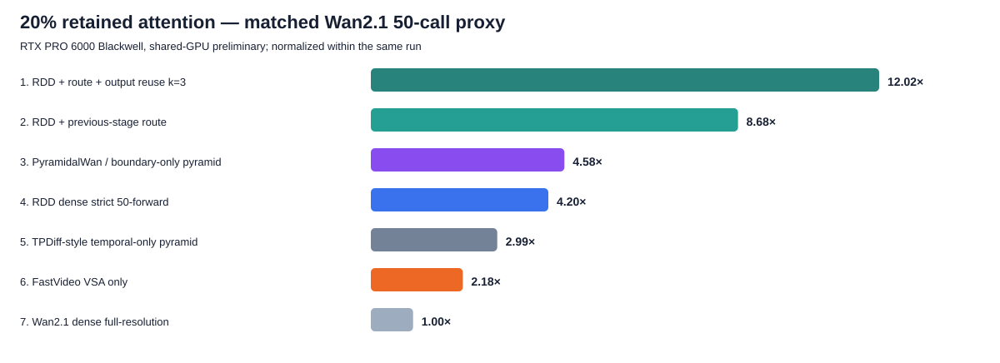
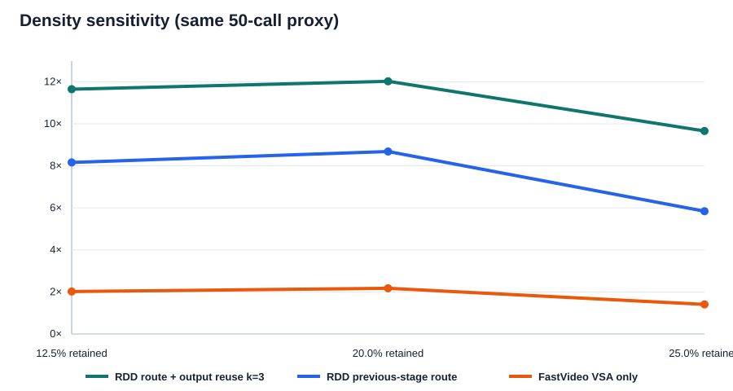

# RDD 视频生成速度：理论排序与无 checkpoint 实测

## 一句话结论

在同一个 Wan2.1-1.3B 形状、同样 50 次 denoiser forward、保留 20% attention blocks 的速度代理中，当前排序为：

1. RDD + 上一分辨率 route + 每 3 步复用 attention output：**12.021×**；
2. RDD + 上一分辨率 route：**8.683×**；
3. PyramidalWan 式纯多分辨率：**4.579×**；
4. 纯 RDD：**4.197×**；
5. temporal-only pyramid：**2.989×**；
6. 只有 VSA、没有蒸馏的 FastVideo：**2.176×**；
7. 原始 dense Wan：1×。

这证明了**速度潜力**，没有证明等质量。尤其是完整 FastVideo 还包含 3-step DMD；未蒸馏的 50-call RDD 不能据此宣称系统级快于完整 FastVideo。

## 公平比较是怎么做的

- 骨干统一为 Wan2.1-T2V-1.3B：dim=1536、FFN=8960、12 heads、30 layers、head dim=128。
- 输出统一为 81×448×832；三层 token grid 是 6×7×13=546、11×14×26=4004、21×28×52=30576。
- 不加载 checkpoint，只用随机 BF16 张量测 kernel；因此没有把不同论文的模型大小、分辨率、CPU offload 混成一个假公平的毫秒表。
- VSA 和 RDD route 使用**同一份、未修改的 FastVideo Triton64 block-sparse executor**。差异只在 route 来源：VSA 每层每步由当前 fine Q/K/V 在线计算；RDD 在 stage 边界从上一层 route 映射一次。
- 真实机器是 RTX PRO 6000 Blackwell。GPU 0 同时有既有训练，结果是共享 GPU 初测；峰值额外显存 2.01 GiB，没有停止任何训练。

## 理论 FLOP 排序（20%）

| rank | method | C/M/F calls | speedup | probability cache | status |
|---|---|---|---|---|---|
| 1 | RDD + route + attention-output reuse k=3 | 19/20/11 | 10.964× | 0.0 GiB | deployable proxy; quality unverified |
| 2 | RDD + route + probability reuse k=3 | 19/20/11 | 9.050× | 168.3 GiB | research prototype; memory-limited |
| 3 | RDD + previous-stage route | 19/20/11 | 7.713× | 0.0 GiB | our proposed method |
| 4 | PyramidalWan / boundary-only pyramid | 20/20/10 | 4.464× | 0.0 GiB | released path / matched proxy |
| 5 | RDD dense, strict 50-forward | 19/20/11 | 4.101× | 0.0 GiB | our planned method |
| 6 | TPDiff-style temporal-only pyramid | 20/20/10 | 2.500× | 0.0 GiB | matched Wan proxy |
| 7 | FastVideo VSA only | 0/0/50 | 2.021× | 0.0 GiB | released method |
| 8 | Wan2.1 dense full-resolution | 0/0/50 | 1.000× | 0.0 GiB | released baseline |

完整 attention probability/score cache 排名看似高，但需要约 **168.3 GiB**，模型本身还没算，所以不是可部署主线。本文实现并实测的是 O(ND) 的 attention-output reuse。

## 真实 kernel + 30-layer 组合代理（20%）

| rank | method | C/M/F calls | speedup | status |
|---|---|---|---|---|
| 1 | RDD + route + output reuse k=3 | 19/20/11 | 12.021× | quality unverified |
| 2 | RDD + previous-stage route | 19/20/11 | 8.683× | our proposed method |
| 3 | PyramidalWan / boundary-only pyramid | 20/20/10 | 4.579× | released path / matched proxy |
| 4 | RDD dense strict 50-forward | 19/20/11 | 4.197× | our planned method |
| 5 | TPDiff-style temporal-only pyramid | 20/20/10 | 2.989× | matched Wan proxy |
| 6 | FastVideo VSA only | 0/0/50 | 2.176× | released method |
| 7 | Wan2.1 dense full-resolution | 0/0/50 | 1.000× | released baseline |

这里的毫秒是把真实 kernel/component latency 组合成 30-layer denoiser proxy；不包含 T5、VAE、通信、Python pipeline 和视频质量。

### 为什么表里纯 RDD 略慢于 PyramidalWan？

这不是 RDD drift 更耗时。当前“严格 50-forward”RDD 为了计入三个 stage endpoint，被记为 **19/20/11**；PyramidalWan 公开日程直接记为 **20/20/10**。两者都是 50 calls，但 RDD 多了一次最贵的 fine call、少了一次最便宜的 coarse call，因此是 4.197× 对 4.579×。如果都严格使用同一个 20/20/10 forward 日程，随机张量速度代理完全相同；RDD 的逐元素 drift 成本相对 DiT forward 可以忽略。最终质量和所需步数才可能让二者真正拉开。

## 每种方法到底做了什么

1. **Dense Wan**：81 帧 448×832 的所有 denoising step 都在最高 latent/token 分辨率做完整 attention。
2. **纯 RDD**：先生成 coarse，再 middle，再 fine；每层仍是 dense attention。节省来自大量 forward 在较短序列上完成，不来自 attention sparsity。
3. **PyramidalWan 式多分辨率**：同样按 coarse/middle/fine 生成，但使用论文的 stage transition/patchification 和 finetuning设计。速度模型只关心每层 token 数和 calls，所以相同 schedule 时与纯 RDD 同速；两者的差异主要是训练目标、transition 和质量。
4. **TPDiff-style temporal-only**：只逐步增加帧率，空间分辨率从始至终保持最高；所以比全时空 pyramid 少省一部分。
5. **Pyramid Flow**：用 flow matching 把生成过程切成三个空间/时间 pyramid stage，并且按 autoregressive unit 扩展视频。它不是 Wan 骨干，报告中只复用了官方 10/10/10 schedule。
6. **FastVideo VSA-only**：仍然是原来的 50 个 full-resolution Wan denoising calls，但把每层 dense attention 换成 VSA。VSA先把当前 fine Q/K/V 压成 64-token cubes，做一次 coarse attention 选 Top-K，再在选中的 fine cube pairs 内执行 sparse QK/AV，最后把 coarse/fine output融合。它**没有缩短 diffusion steps**。
7. **RDD previous-stage route**：coarse stage 保持 dense；coarse 最后的 attention route 映射给 middle，middle 再映射给 fine。middle/fine 用与 VSA相同的 sparse executor，但不在每层每步重新运行 current-fine router。
8. **RDD output reuse**：每 k=3 步只在第一个 step 真正计算 self-attention branch；后两个 step 使用缓存的 attention output，再继续计算当前 step 的 FFN/cross-attention等。它不是缓存完整 attention probability，质量需要验证。
9. **Probability reuse**：缓存稀疏的方形 attention matrix，并计算 `A_old × V_current`。数学上更接近“复用 attention score”，但当前 Wan grid、30 layers、20%密度约需168.3 GiB，仅适合少数层或更小窗口，不适合作为默认系统。

## FastVideo 最快版本：不是 VSA-only

FastVideo 当前最快的 Wan2.1-1.3B 公开路径是 **Sparse-Distill = 3-step DMD + VSA**。我们已经在同一实测组件模型中加入它：

| rank | method | C/M/F calls | speedup vs dense Wan50 | status |
|---|---|---|---|---|
| 1 | RDD distilled 2/2/1 + previous-stage route | 2/2/1 | 93.828× | hypothetical until trained |
| 2 | PyramidalWan DMD 2/2/1 | 2/2/1 | 45.786× | released method |
| 3 | RDD distilled 2/2/1 dense | 2/2/1 | 45.786× | hypothetical until trained |
| 4 | FastVideo DMD3 + VSA | 0/0/3 | 36.267× | released method |
| 5 | Pyramid Flow 10/10/10 schedule on Wan proxy | 10/10/10 | 4.780× | official schedule / matched Wan proxy |

其中 FastVideo DMD3+VSA 的代理为 **36.267×**；VSA-only 是 2.176×。约 16.7 倍的差距主要来自把 50 calls 降到 3 calls，不是 VSA kernel 突然变快。RDD distilled 2/2/1 行是尚未训练的假设，只能作为未来硬件目标，不能当当前结果。

另外，“Fast Video Generation with Sliding Tile Attention”这篇 ICML 2025 论文的核心是 **STA**，在 HunyuanVideo 上报告 training-free 和 finetuned 版本；它和当前 FastVideo/Wan 的 VSA/Sparse-Distill 路线不是同一个实验。当前 FastVideo 主仓库已把 STA 归档，并明确优先维护 VSA，因此本次 Wan 公平表采用 VSA 与 DMD3+VSA，而不把 Hunyuan 720p 的 STA 毫秒混进来。

## 稀疏率敏感性

| retained | RDD route+reuse | RDD route | FastVideo VSA-only |
|---|---|---|---|
| 12.5% | 11.645× | 8.161× | 2.019× |
| 20.0% | 12.021× | 8.683× | 2.176× |
| 25.0% | 9.659× | 5.842× | 1.406× |

注意 20% 在这次共享 GPU 测量中反而比 12.5% 快，这是并发训练、GPU 时钟和 kernel autotune 噪声，不是算法规律。当前可相信的是方法的大致层级；稀疏率之间的精确差值必须等 GPU 独占后重跑。

Wan 视频的 fine stage 实测组件如下。VSA 总成本在排序中按“相同 sparse executor + 单独实测 router”相加，避免共享 GPU 插队造成 VSA 比其子操作还快的物理不可能结果。

| retained | dense SDPA ms | same sparse executor ms | VSA online router ms |
|---|---|---|---|
| 12.5% | 33.220 | 9.786 | 0.444 |
| 20.0% | 33.220 | 8.104 | 0.493 |
| 25.0% | 33.220 | 19.619 | 0.443 |

RDD route-lifting kernel 在 20% 下把 coarse→middle 映射到平均 20.52%，middle→fine 映射到平均 20.24%；两次 stage-boundary kernel 的 median 分别为 0.04010 ms 和 0.01618 ms。它只在边界发生，不是每个 denoising step 都重算。

正确性检查也已通过：6 组 route lift（两种 stage transition × 三种 density）全部与 CPU 参考索引逐项完全相等；五种 token shape 的 output-reuse kernel 相对 `x + cached` 最大绝对误差均为 0。

## 不同 RDD 步数分配（20%）

| rank | method | C/M/F calls | speedup |
|---|---|---|---|
| 1 | RDD + route + output reuse k=3 — coarse-heavy 30/15/5 (+ endpoints) | 31/16/6 | 19.835× |
| 2 | RDD + previous-stage route — coarse-heavy 30/15/5 (+ endpoints) | 31/16/6 | 14.372× |
| 3 | RDD + route + output reuse k=3 — strict 18/19/10 (+ endpoints) | 19/20/11 | 12.021× |
| 4 | RDD + route + output reuse k=3 — balanced 20/20/10 (+ endpoints) | 21/21/11 | 11.917× |
| 5 | RDD + previous-stage route — strict 18/19/10 (+ endpoints) | 19/20/11 | 8.683× |
| 6 | RDD + previous-stage route — balanced 20/20/10 (+ endpoints) | 21/21/11 | 8.609× |
| 7 | RDD dense — coarse-heavy 30/15/5 (+ endpoints) | 31/16/6 | 7.290× |
| 8 | RDD + route + output reuse k=3 — fine-heavy 10/15/25 (+ endpoints) | 11/16/26 | 5.768× |
| 9 | RDD dense — strict 18/19/10 (+ endpoints) | 19/20/11 | 4.197× |
| 10 | RDD dense — balanced 20/20/10 (+ endpoints) | 21/21/11 | 4.178× |
| 11 | RDD + previous-stage route — fine-heavy 10/15/25 (+ endpoints) | 11/16/26 | 4.068× |
| 12 | RDD dense — fine-heavy 10/15/25 (+ endpoints) | 11/16/26 | 1.873× |

“coarse-heavy”速度最高是必然的，因为 coarse token 少；这**不是质量结论**。下一步必须用同一 RDD-Wan checkpoint/finetuning预算比较 VBench、FVD、CLIP、motion 和人工偏好，否则不能选它作为最佳 schedule。

## 与公开方法的真实关系

- **PyramidalWan**：公开 20/20/10 和 DMD 2/2/1。论文表中 50-step Wan 为 12,592 TFLOPs、20/20/10 为 2,821 TFLOPs，即 4.46×；本代理的 4.56×与它一致，说明 token/call cost model 量级可信。
- **Pyramid Flow**：代码公开，但使用 miniFLUX/SD3、autoregressive pyramid 和不同分辨率。我在 surfi2 浅克隆了官方仓库，并实际导入其 `PyramidFlowMatchEulerDiscreteScheduler`：三阶段均生成 10 个 timestep，确认官方视频路径为 10/10/10。速度表只把这个日程放进统一 Wan proxy；没有把不同骨干的原始毫秒冒充为公平比较。
- **TPDiff**：只降低时间帧率，论文报告 1.5×；其官方仓库截至本次检查仍只有 assets/README，并写着代码将发布，所以这里只能做 Wan-shape temporal-only proxy。
- **PAB**：训练免费地复用 attention output，并报告最高 10.5×。RDD 的 `output reuse k=3` 是相同类别的速度上界，不是复用完整 N×N attention probability。
- **FastVideo**：VSA-only 和完整 Sparse-Distill 必须分开。官方 1.3B recipe 是 3-step DMD + VSA，VSA sparsity=0.8（保留约 20%），训练 4000 steps；它的巨大系统级加速主要同时来自步数减少和稀疏 attention。

## 我认为最值得做的路线

1. 先做 RDD-Wan 20/20/10（或严格 50-call）质量基线，证明多分辨率本身不掉 VBench/FVD。
2. 只给 middle/fine 加 external route，扫 12.5/20/25%；coarse 保持 dense。
3. 再加 k=2/3 的 attention-output reuse；先按 layer 和 timestep 自适应，不能盲目所有层每 3 步复用。
4. 最后做 2/2/1 或 3/1/1 蒸馏。只有这一项完成后，才可与 FastVideo DMD3+VSA 做系统级 wall-clock/quality Pareto。

## 产物

- 理论模型：`rdd_video/attention_analysis/model_video_method_speed.py`
- 实测驱动：`rdd_video/attention_analysis/benchmark_wan_video_methods.py`
- 跨分辨率 route Triton kernel：`rdd_video/attention_analysis/rdd_video_route_triton.py`
- attention-output reuse Triton kernel：`rdd_video/attention_analysis/rdd_video_reuse_triton.py`
- Pyramid Flow 官方 scheduler 无 checkpoint 验证：`rdd_video/attention_analysis/verify_pyramid_flow_official_schedule.py`
- 原始 JSON/CSV/日志：`eval_results/rdd_video_speed_benchmark_shared_gpu0/`

## 主要来源

- Wan2.1 official config: https://github.com/Wan-Video/Wan2.1/blob/main/wan/configs/wan_t2v_1_3B.py
- FastVideo/VSA: https://github.com/hao-ai-lab/FastVideo/blob/main/docs/attention/vsa/index.md
- FastVideo sparse-distill: https://github.com/hao-ai-lab/FastVideo/blob/main/docs/distillation/dmd.md
- PyramidalWan: https://openaccess.thecvf.com/content/CVPR2026/papers/Korzhenkov_PyramidalWan_On_Making_Pretrained_Video_Model_Pyramidal_for_Efficient_Inference_CVPR_2026_paper.pdf
- Pyramid Flow official code: https://github.com/jy0205/Pyramid-Flow
- TPDiff official repository: https://github.com/showlab/TPDiff
- PAB: https://arxiv.org/abs/2408.12588
